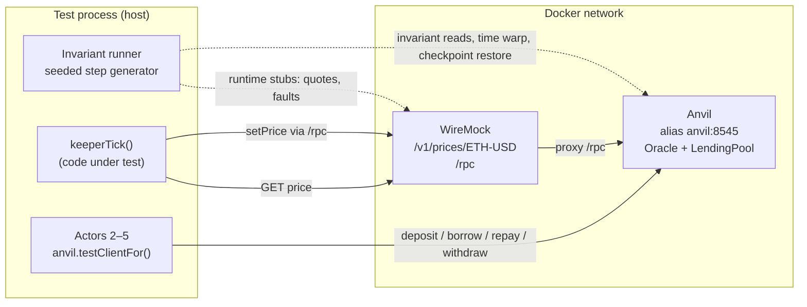

## Your Contract Is Correct. Your Protocol Isn't.

Invariant testing is one of the best tools a Solidity team has. Describe something that must **always** be true (e.g. the pool is solvent, debts add up, the oracle price is sane) and let a fuzzer throw random sequences of calls at the system until something breaks. If you haven't written one yet, the [Solidity Testing Book chapter on invariant tests](https://www.soliditytestingbook.com/advanced/invariant-tests) is a good introduction to handlers, actors and bounded inputs in Foundry.

Forge's invariant fuzzer has one hard limit: **it runs inside the EVM.** It cannot run:

- the TypeScript keeper that pushes prices on-chain every few minutes
- the REST price API that keeper depends on
- a RPC provider, with its `503`s, dropped sockets and slow responses
- viem or ethers encoding, nonce handling, timeouts and retry logic

That's where many real incidents start. The contract executes as expected but the off-chain code told it something wrong.

This article shows how to take the invariant-testing model **end to end**: random sequences of real transactions from multiple actors, real keeper runs, and injected network faults, all against a real Anvil node, with protocol invariants checked after every step. We'll use two open-source Hella Labs modules:

- [`@hellaweb3/foundryanvil-testcontainers-nodejs`](https://www.npmjs.com/package/@hellaweb3/foundryanvil-testcontainers-nodejs) ([GitHub](https://github.com/hella-labs/foundryanvil-testcontainers-nodejs)) runs Foundry Anvil in Docker with a typed viem test client, snapshots and cheats.
- [`@hellaweb3/wiremock-testcontainers-nodejs`](https://www.npmjs.com/package/@hellaweb3/wiremock-testcontainers-nodejs) ([GitHub](https://github.com/hella-labs/wiremock-testcontainers-nodejs)) runs WireMock in Docker to fake the price API and inject faults into JSON-RPC traffic.

<Callout type="tip">
  This builds on two earlier guides: [Solidity lifecycle testing with Foundry Anvil
  Testcontainers](/solidity-lifecycle-testing-foundry-anvil/) and [on-chain chaos engineering with
  WireMock and Anvil](/on-chain-chaos-engineering-ethereum-wiremock-anvil/). You don't need to have
  read them, but they cover the container setup in more depth.
</Callout>

---

<IconDivider icon="fa6-solid:diagram-project" />

## Forge Invariants vs. End-to-End Invariants

The two approaches answer different questions, and you want both.

|                    | Forge invariant tests           | End-to-end invariant tests                                           |
| ------------------ | ------------------------------- | -------------------------------------------------------------------- |
| **Runs**           | In-process EVM                  | Real Anvil node in Docker, over JSON-RPC                             |
| **Fuzzes**         | Contract calls                  | Contract calls, keeper runs, API responses, RPC faults, time         |
| **Speed**          | Thousands of calls per second   | Tens of transactions per second                                      |
| **Typical budget** | 256 runs × 500 calls            | 32 runs × 25 steps per PR, more nightly                              |
| **Finds**          | Logic bugs inside the contracts | Bugs at the boundary between contracts and the code that drives them |

Forge gives you breadth: huge numbers of sequences, cheap and fast. The end-to-end harness gives you depth: fewer sequences, but each one goes through the real code path your users and operators will hit. Keep your Forge suite. Add this one for the parts Forge can't reach.

---

<IconDivider icon="fa6-solid:cubes" />

## The System Under Test

Our example is a small lending market with three moving parts.

**1. A price oracle** that only the keeper may update:

```solidity
// SPDX-License-Identifier: MIT
pragma solidity ^0.8.24;

contract PriceOracle {
    address public immutable keeper;
    uint256 public price; // USD per WETH, 8 decimals
    uint256 public updatedAt;

    error NotKeeper();

    constructor(address keeper_) {
        keeper = keeper_;
    }

    function setPrice(uint256 newPrice) external {
        if (msg.sender != keeper) revert NotKeeper();
        price = newPrice;
        updatedAt = block.timestamp;
    }
}
```

**2. A lending pool.** Users deposit WETH as collateral and borrow a stablecoin against it, up to 75% of the collateral's value. It refuses to price positions with an oracle value older than one hour:

```solidity
// SPDX-License-Identifier: MIT
pragma solidity ^0.8.24;

import {IERC20} from "@openzeppelin/contracts/token/ERC20/IERC20.sol";
import {PriceOracle} from "./PriceOracle.sol";

contract LendingPool {
    uint256 public constant LTV_BPS = 7_500; // borrow up to 75% of collateral value
    uint256 public constant MAX_PRICE_AGE = 1 hours;

    IERC20 public immutable collateral; // WETH, 18 decimals
    IERC20 public immutable stable; // USD stablecoin, 18 decimals
    PriceOracle public immutable oracle;

    mapping(address => uint256) public collateralOf;
    mapping(address => uint256) public debtOf;
    uint256 public totalCollateral;
    uint256 public totalDebt;

    error Unhealthy();
    error StalePrice();

    constructor(IERC20 collateral_, IERC20 stable_, PriceOracle oracle_) {
        collateral = collateral_;
        stable = stable_;
        oracle = oracle_;
    }

    function deposit(uint256 amount) external {
        collateralOf[msg.sender] += amount;
        totalCollateral += amount;
        collateral.transferFrom(msg.sender, address(this), amount);
    }

    function withdraw(uint256 amount) external {
        collateralOf[msg.sender] -= amount;
        totalCollateral -= amount;
        _requireHealthy(msg.sender);
        collateral.transfer(msg.sender, amount);
    }

    function borrow(uint256 amount) external {
        debtOf[msg.sender] += amount;
        totalDebt += amount;
        _requireHealthy(msg.sender);
        stable.transfer(msg.sender, amount);
    }

    function repay(uint256 amount) external {
        debtOf[msg.sender] -= amount;
        totalDebt -= amount;
        stable.transferFrom(msg.sender, address(this), amount);
    }

    function _requireHealthy(address user) internal view {
        if (debtOf[user] == 0) return;
        if (block.timestamp - oracle.updatedAt() > MAX_PRICE_AGE) revert StalePrice();
        uint256 value = (collateralOf[user] * oracle.price()) / 1e8;
        if (debtOf[user] * 10_000 > value * LTV_BPS) revert Unhealthy();
    }
}
```

**3. An off-chain keeper** in TypeScript. It fetches the ETH/USD price from an HTTP API and pushes it to the oracle through an RPC endpoint:

```ts
// src/keeper.ts
import type { Account, Address, Chain, Transport, WalletClient } from "viem";
import { oracleAbi } from "./abis";

export interface KeeperDeps {
  priceApiUrl: string;
  wallet: WalletClient<Transport, Chain, Account>;
  oracle: Address;
}

/** One keeper cycle. Returns true when a new price was pushed on-chain. */
export async function keeperTick({ priceApiUrl, wallet, oracle }: KeeperDeps): Promise<boolean> {
  let quote: { price: number | null };
  try {
    const res = await fetch(`${priceApiUrl}/v1/prices/ETH-USD`, {
      signal: AbortSignal.timeout(1_000),
    });
    if (!res.ok) return false; // provider down: keep the last on-chain price
    quote = (await res.json()) as { price: number | null };
  } catch {
    return false; // timeout or dropped connection
  }

  const price = BigInt(Math.round(Number(quote.price) * 1e8)); // 8-decimal fixed point

  try {
    await wallet.writeContract({
      address: oracle,
      abi: oracleAbi,
      functionName: "setPrice",
      args: [price],
    });
    return true;
  } catch {
    return false; // RPC failure: try again next cycle
  }
}
```

Read that keeper again. It handles HTTP errors, timeouts and RPC failures. It looks careful. There's still a bug in it, and Forge can't find it, because Forge never runs this file. Let's build a harness that can.

---

<IconDivider icon="fa6-brands:docker" />

## The Test Topology

Everything runs in Docker through [Testcontainers](https://testcontainers.com/). One WireMock container plays two roles:

- the **price API** at `/v1/prices/ETH-USD`, whose response the fuzzer controls
- a **transparent JSON-RPC proxy** at `/rpc`, forwarding the keeper's transactions to Anvil, so the fuzzer can break the keeper's RPC connection



The actors talk to Anvil directly, since their transactions are the fuzz input, not the thing being broken. Only the keeper's traffic goes through WireMock.

### Start the containers

`useAnvil()` manages one Anvil node per test file and runs a `setup` hook once after start. We use it to deploy the contracts from Foundry's `out/` directory:

```ts
// test/invariant/lending.invariant.e2e.test.ts
import {
  AnvilContainer,
  AnvilOptions,
  useAnvil,
} from "@hellaweb3/foundryanvil-testcontainers-nodejs";
import {
  type StartedWiremockContainer,
  WiremockContainer,
} from "@hellaweb3/wiremock-testcontainers-nodejs";
import { Network, type StartedNetwork } from "testcontainers";
import { createWalletClient, http } from "viem";
import { deployMarket, type Market } from "./fixtures";

let network: StartedNetwork;
let market: Market;
let wiremock: StartedWiremockContainer;

const anvil = useAnvil(
  {
    start: async () => {
      network = await new Network().start();
      return new AnvilContainer(new AnvilOptions().account.withAccounts(6).logs.quiet())
        .withArtifactsDir("out") // forge build output
        .withTestClient((client) => client.withAccount(0))
        .withNetwork(network)
        .withNetworkAliases("anvil")
        .start();
    },
  },
  { setup: async (node) => (market = await deployMarket(node)) },
);

beforeAll(async () => {
  wiremock = await new WiremockContainer()
    .withNetwork(network)
    .withMapping("rpc-proxy", { json: PROXY_TO_ANVIL })
    .withMapping("price-baseline", { json: quoteStub(3_000) })
    .start();
  await wiremock.waitUntilReady();
}, 120_000);

afterAll(async () => {
  await wiremock?.stop();
  await network?.stop();
});
```

`deployMarket()` deploys two mock ERC-20s, the oracle and the pool, seeds the pool with stablecoin liquidity, gives every actor 100 WETH, approves the pool for both tokens, and has the keeper push an opening price of $3,000. Each deployment is one call:

```ts
const name = "LendingPool";
const receipt = await node.deployContract(
  node.contractAbi(`${name}.sol/${name}.json`),
  node.contractBytecode(`${name}.sol/${name}.json`),
  deployer,
  [weth, usd, oracle],
);
const pool = receipt.contractAddress as Address;
```

The two baseline WireMock stubs are plain objects. The proxy forwards everything under `/rpc` to Anvil at low priority, and the quote stub serves a healthy price:

```ts
export const PRICE_PATH = "/v1/prices/ETH-USD";

export const PROXY_TO_ANVIL = {
  priority: 100, // lowest: any fault stub wins
  request: { method: "ANY", urlPath: "/rpc" },
  response: { proxyBaseUrl: "http://anvil:8545", proxyUrlPrefixToRemove: "/rpc" },
};

export const quoteStub = (price: number | null, response: object = {}) => ({
  priority: 5,
  request: { method: "GET", urlPath: PRICE_PATH },
  response: { status: 200, jsonBody: { symbol: "ETH-USD", price }, ...response },
});
```

<Callout type="warning">
  Both `@hellaweb3/*` modules depend on `testcontainers@^12`. Keep your own `testcontainers`
  dependency on the same major version, or a `Network` created by one copy can't be passed to
  containers from the other.
</Callout>

---

<IconDivider icon="fa6-solid:code-branch" />

## Step 1: Deterministic Fuzz Input

A fuzzer you can't replay is a fuzzer you can't debug. Every random choice in the harness comes from one seeded PRNG, so a failing seed always reproduces the same sequence:

```ts
// test/invariant/rng.ts
export type Rng = () => number; // uniform in [0, 1)

/** mulberry32: tiny, fast and good enough for test input. */
export function mulberry32(seed: number): Rng {
  let a = seed >>> 0;
  return () => {
    a = (a + 0x6d2b79f5) >>> 0;
    let t = a;
    t = Math.imul(t ^ (t >>> 15), t | 1);
    t ^= t + Math.imul(t ^ (t >>> 7), t | 61);
    return ((t ^ (t >>> 14)) >>> 0) / 4_294_967_296;
  };
}

/**
 * Like forge-std's bound(): maps a raw fuzz value into [min, max].
 * The lowest and highest 5% of raw values snap to the edges, since edges are where bugs live.
 */
export function bound(raw: number, min: bigint, max: bigint): bigint {
  if (max <= min) return min;
  if (raw < 0.05) return min;
  if (raw >= 0.95) return max;
  return min + ((max - min) * BigInt(Math.floor(raw * 1e9))) / 1_000_000_000n;
}
```

A **step** is pure data: which action to run, which actor runs it, and a raw number the action turns into concrete arguments. Generating steps up front, without reading chain state, matters later: it lets us replay and shrink a failing sequence exactly.

```ts
// test/invariant/steps.ts
export type ActionName =
  | "deposit"
  | "withdraw"
  | "borrow"
  | "repay"
  | "keeperTick"
  | "quoteMoves"
  | "priceApiFault"
  | "rpcFault"
  | "warp";

export interface Step {
  action: ActionName;
  actor: number; // index into ctx.actors
  raw: number; // fuzz value in [0, 1), turned into arguments by the action
}

// Relative frequencies. Leaving an action out works like Foundry's targetSelector.
const WEIGHTS: Record<ActionName, number> = {
  deposit: 3,
  withdraw: 2,
  borrow: 3,
  repay: 2,
  keeperTick: 3,
  quoteMoves: 2,
  priceApiFault: 1,
  rpcFault: 1,
  warp: 1,
};

const BAG = (Object.entries(WEIGHTS) as [ActionName, number][]).flatMap(([name, weight]) =>
  Array<ActionName>(weight).fill(name),
);

export function generate(rng: Rng, depth: number): Step[] {
  return Array.from({ length: depth }, () => ({
    action: BAG[Math.floor(rng() * BAG.length)]!,
    actor: Math.floor(rng() * 4),
    raw: rng(),
  }));
}
```

---

<IconDivider icon="fa6-solid:wand-magic-sparkles" />

## Step 2: Handlers for Users, Keepers and Chaos

Handlers are the end-to-end version of a Forge handler contract. Each one bounds its input against **current chain state**, so most calls are realistic, and returns an outcome the runner counts:

- `ok`: the transaction succeeded
- `revert`: the contract rejected it on purpose (for example `Unhealthy`)
- `discard`: the step makes no sense right now (no collateral to withdraw), so it's skipped

Every handler shares a context object that holds the containers, addresses and **ghost state**: values the test tracks off-chain so invariants can compare the chain against them.

```ts
// test/invariant/context.ts
import type { StartedAnvilContainer } from "@hellaweb3/foundryanvil-testcontainers-nodejs";
import type { StartedWiremockContainer } from "@hellaweb3/wiremock-testcontainers-nodejs";
import type { Account, Address } from "viem";

export interface Ghost {
  quote: number; // USD price the API serves while healthy
  validQuotes: Set<bigint>; // every well-formed price the API has served, 8 decimals
  faults: number; // counter for unique WireMock scenario names
}

export interface Ctx {
  anvil: StartedAnvilContainer<Account>;
  wiremock: StartedWiremockContainer;
  market: Market; // pool, oracle, weth, usd addresses + seeded liquidity
  actors: Address[]; // dev accounts 2–5
  keeper: Address; // dev account 1
  ghost: Ghost;
}

export const toFixed8 = (usd: number) => BigInt(Math.round(usd * 1e8));
export const freshGhost = (): Ghost => ({
  quote: 3_000,
  validQuotes: new Set([toFixed8(3_000)]),
  faults: 0,
});
```

Two small helpers keep the handlers short. `tx()` sends a transaction as an actor and sorts failures into **expected reverts** and **everything else**:

```ts
// test/invariant/tx.ts
import { AnvilTransactionRevertedError } from "@hellaweb3/foundryanvil-testcontainers-nodejs";
import { type Abi, type Address, BaseError, ContractFunctionRevertedError } from "viem";

export function isRevert(err: unknown): boolean {
  if (err instanceof AnvilTransactionRevertedError) return true; // mined, then reverted
  return (
    err instanceof BaseError && // rejected during gas estimation
    err.walk((e) => e instanceof ContractFunctionRevertedError) !== null
  );
}

export async function tx(
  ctx: Ctx,
  from: Address,
  call: { address: Address; abi: Abi; functionName: string; args: readonly unknown[] },
): Promise<"ok" | "revert"> {
  try {
    await ctx.anvil.confirm(ctx.anvil.testClientFor(from).writeContract(call));
    return "ok";
  } catch (err) {
    if (isRevert(err)) return "revert";
    throw err; // an RPC or encoding error is a harness bug, not a finding: fail loudly
  }
}

export const read = (
  ctx: Ctx,
  address: Address,
  abi: Abi,
  functionName: string,
  args: readonly unknown[] = [],
) => ctx.anvil.testClient.readContract({ address, abi, functionName, args }) as Promise<bigint>;
```

<Callout type="important">
  Don't wrap handler calls in a `try`/`catch` that swallows every error. A blanket catch turns real
  bugs into "reverts" and quietly makes the suite useless. Only a contract revert is an expected
  outcome; anything else should fail the test.
</Callout>

### User actions

The user handlers drive the pool from four actors. `borrow` deliberately overshoots the borrowing capacity by up to 10%, so the health check gets exercised too. It also checks a **postcondition**: if the oracle price was already stale, the borrow must not succeed.

```ts
// test/invariant/actions.ts
type Outcome = "ok" | "revert" | "discard";
type Action = (ctx: Ctx, actor: Address, raw: number) => Promise<Outcome>;

const userActions = {
  async deposit(ctx, actor, raw) {
    const { weth, pool } = ctx.market;
    const balance = await read(ctx, weth, erc20Abi, "balanceOf", [actor]);
    if (balance === 0n) return "discard";
    const amount = bound(raw, 1n, balance);
    return tx(ctx, actor, { address: pool, abi: poolAbi, functionName: "deposit", args: [amount] });
  },

  async withdraw(ctx, actor, raw) {
    const { pool } = ctx.market;
    const deposited = await read(ctx, pool, poolAbi, "collateralOf", [actor]);
    if (deposited === 0n) return "discard";
    const amount = bound(raw, 1n, deposited);
    return tx(ctx, actor, {
      address: pool,
      abi: poolAbi,
      functionName: "withdraw",
      args: [amount],
    });
  },

  async borrow(ctx, actor, raw) {
    const { pool, oracle } = ctx.market;
    const [collateral, debt, price, updatedAt, now] = await Promise.all([
      read(ctx, pool, poolAbi, "collateralOf", [actor]),
      read(ctx, pool, poolAbi, "debtOf", [actor]),
      read(ctx, oracle, oracleAbi, "price"),
      read(ctx, oracle, oracleAbi, "updatedAt"),
      ctx.anvil.latestTimestamp(),
    ]);
    const capacity = (collateral * price * 7_500n) / (100_000_000n * 10_000n) - debt;
    if (capacity <= 0n) return "discard";

    const amount = bound(raw, 1n, capacity + capacity / 10n);
    const stale = now - updatedAt > 3_600n;
    const outcome = await tx(ctx, actor, {
      address: pool,
      abi: poolAbi,
      functionName: "borrow",
      args: [amount],
    });

    if (outcome === "ok" && stale) {
      throw new Violation(
        "noBorrowOnStalePrice",
        `borrowed ${amount} at a price ${now - updatedAt}s old`,
      );
    }
    return outcome;
  },

  async repay(ctx, actor, raw) {
    const { pool, usd } = ctx.market;
    const [debt, balance] = await Promise.all([
      read(ctx, pool, poolAbi, "debtOf", [actor]),
      read(ctx, usd, erc20Abi, "balanceOf", [actor]),
    ]);
    const max = debt < balance ? debt : balance;
    if (max === 0n) return "discard";
    return tx(ctx, actor, {
      address: pool,
      abi: poolAbi,
      functionName: "repay",
      args: [bound(raw, 1n, max)],
    });
  },
} satisfies Record<string, Action>;
```

### Keeper and chaos actions

This is the part Forge can't do. `keeperTick` runs the **real keeper module**, with its wallet pointed at WireMock's `/rpc` proxy. The chaos actions change what the price API returns, break the keeper's next transaction, or move time forward.

Runtime stubs are POSTed to WireMock's admin API at `wiremock.getMappingUrl()`. When two stubs have the same priority, WireMock uses the one added most recently, so each new quote or fault replaces the previous one.

```ts
const addStub = (ctx: Ctx, stub: object) =>
  fetch(ctx.wiremock.getMappingUrl(), { method: "POST", body: JSON.stringify(stub) });

const PRICE_FAULTS = [
  { label: "503", stub: () => quoteStub(null, { status: 503, jsonBody: undefined }) },
  { label: "connection reset", stub: () => quoteStub(null, { fault: "CONNECTION_RESET_BY_PEER" }) },
  { label: "slow (1.5s)", stub: (q: number) => quoteStub(q, { fixedDelayMilliseconds: 1_500 }) },
  { label: "200 with null price", stub: () => quoteStub(null) },
];

const systemActions = {
  async keeperTick(ctx) {
    const wallet = createWalletClient({
      account: ctx.keeper, // unlocked dev account: Anvil signs
      chain: ctx.anvil.chain,
      transport: http(ctx.wiremock.getUrl("/rpc")),
    });
    const pushed = await keeperTick({
      priceApiUrl: ctx.wiremock.getUrl(),
      wallet,
      oracle: ctx.market.oracle,
    });
    return pushed ? "ok" : "revert";
  },

  async quoteMoves(ctx, _actor, raw) {
    // The market moves up to ±10% per step
    const next = Math.round(ctx.ghost.quote * (0.9 + raw * 0.2) * 100) / 100;
    ctx.ghost.quote = next;
    ctx.ghost.validQuotes.add(toFixed8(next));
    await addStub(ctx, quoteStub(next));
    return "ok";
  },

  async priceApiFault(ctx, _actor, raw) {
    const fault = PRICE_FAULTS[Math.floor(raw * PRICE_FAULTS.length)]!;
    await addStub(ctx, fault.stub(ctx.ghost.quote)); // stays broken until the next quoteMoves
    return "ok";
  },

  async rpcFault(ctx) {
    // One-shot 503 on the keeper's next transaction, then back to proxying
    await addStub(ctx, {
      priority: 1,
      request: {
        method: "POST",
        urlPath: "/rpc",
        bodyPatterns: [{ contains: '"method":"eth_sendTransaction"' }],
      },
      response: { status: 503 },
      scenarioName: `rpc-blip-${ctx.ghost.faults++}`,
      requiredScenarioState: "Started",
      newScenarioState: "recovered",
    });
    return "ok";
  },

  async warp(ctx, _actor, raw) {
    const seconds = Number(bound(raw, 60n, 2n * 3_600n));
    await ctx.anvil.cheats.increaseTime({ seconds }).mine();
    return "ok";
  },
} satisfies Record<string, Action>;

// The compiler checks that every ActionName has exactly one handler
export const actions: Record<ActionName, Action> = { ...userActions, ...systemActions };
```

Together, `warp` and `rpcFault` make a stale oracle reachable: the keeper misses a few cycles, an hour passes, and the `noBorrowOnStalePrice` postcondition checks that the pool refuses to lend against the old price.

---

<IconDivider icon="fa6-solid:shield-halved" />

## Step 3: Write the Invariants

Each invariant reads the chain and returns `undefined` when it holds, or a message explaining why it broke. Checking them after **every step** means a failure points at the exact step that broke the system, not the end of the run.

```ts
// test/invariant/invariants.ts
type Invariant = (ctx: Ctx) => Promise<string | undefined>;

export const invariants: Record<string, Invariant> = {
  /** Every WETH the pool holds is credited to someone, and vice versa. */
  async collateralIsBacked(ctx) {
    const { pool, weth } = ctx.market;
    const [held, recorded] = await Promise.all([
      read(ctx, weth, erc20Abi, "balanceOf", [pool]),
      read(ctx, pool, poolAbi, "totalCollateral"),
    ]);
    return held === recorded ? undefined : `pool holds ${held} WETH but records ${recorded}`;
  },

  /** No interest yet, so stablecoins are conserved: in the pool or out on loan. */
  async stableIsConserved(ctx) {
    const { pool, usd, seededLiquidity } = ctx.market;
    const [held, lent] = await Promise.all([
      read(ctx, usd, erc20Abi, "balanceOf", [pool]),
      read(ctx, pool, poolAbi, "totalDebt"),
    ]);
    return held + lent === seededLiquidity
      ? undefined
      : `held ${held} + lent ${lent} != seeded ${seededLiquidity}`;
  },

  /** Per-user debts add up to the pool's total (iterate over every actor). */
  async debtsSumToTotal(ctx) {
    const { pool } = ctx.market;
    const debts = await Promise.all(
      ctx.actors.map((actor) => read(ctx, pool, poolAbi, "debtOf", [actor])),
    );
    const sum = debts.reduce((a, b) => a + b, 0n);
    const total = await read(ctx, pool, poolAbi, "totalDebt");
    return sum === total ? undefined : `actor debts sum to ${sum}, totalDebt is ${total}`;
  },

  /** The cross-boundary invariant: the oracle only ever holds a price the API really served. */
  async oracleTracksApi(ctx) {
    const price = await read(ctx, ctx.market.oracle, oracleAbi, "price");
    return ctx.ghost.validQuotes.has(price)
      ? undefined
      : `oracle holds ${price}, which the price API never served as a valid quote`;
  },
};
```

The first three are classic on-chain invariants, and you'd likely have them in Forge too. The last one is only possible end to end: it compares on-chain state against **ghost state about an off-chain system**, the quotes that WireMock actually served.

---

<IconDivider icon="fa6-solid:rotate" />

## Step 4: The Runner, with Checkpoints and Shrinking

The runner ties it together. For each run it generates a sequence from `seed + run`, executes it, and checks every invariant after every step. Between runs, an [Anvil checkpoint](https://hellalabs.dev/foundryanvil-testcontainers-nodejs/docs/tasks/test-suites/isolate-tests) puts the chain back to the post-deployment state in milliseconds, and `wiremock.reset()` drops every runtime stub, scenario and journal entry. No container restarts.

```ts
// test/invariant/runner.ts
export class Violation extends Error {
  step = 0;
  constructor(
    readonly invariant: string,
    detail: string,
  ) {
    super(`${invariant}: ${detail}`);
  }
}

export async function execute(ctx: Ctx, steps: readonly Step[], metrics?: Metrics) {
  for (const [i, step] of steps.entries()) {
    try {
      const actor = ctx.actors[step.actor % ctx.actors.length]!;
      metrics?.record(step.action, await actions[step.action](ctx, actor, step.raw));
      for (const [name, check] of Object.entries(invariants)) {
        const broken = await check(ctx);
        if (broken) throw new Violation(name, broken);
      }
    } catch (err) {
      if (!(err instanceof Violation)) throw err;
      err.step = i + 1;
      return err;
    }
  }
  return undefined;
}
```

When a run fails, a 25-step sequence is hard to read. Forge shrinks failing sequences, and we can do the same: try deleting each step, replay from the checkpoint, and keep the deletion if the **same invariant** still breaks.

```ts
export async function shrink(
  ctx: Ctx,
  restore: () => Promise<void>,
  steps: Step[],
  invariant: string,
): Promise<Step[]> {
  let current = steps;
  for (let i = current.length - 1; i >= 0; i--) {
    const candidate = current.toSpliced(i, 1);
    await restore();
    if ((await execute(ctx, candidate))?.invariant === invariant) current = candidate;
  }
  return current;
}
```

And the test itself:

```ts
const RUNS = Number(process.env.INVARIANT_RUNS ?? 32);
const DEPTH = Number(process.env.INVARIANT_DEPTH ?? 25);
const SEED = Number(process.env.INVARIANT_SEED ?? Date.now() % 2 ** 31);

it(
  `holds every invariant (seed ${SEED}, ${RUNS} runs × ${DEPTH} steps)`,
  async () => {
    const addresses = await anvil.addresses();
    const ctx: Ctx = {
      anvil,
      wiremock,
      market,
      keeper: addresses[1]!,
      actors: addresses.slice(2, 6),
      ghost: freshGhost(),
    };
    const base = await anvil.checkpoint();
    const restore = async () => {
      await base.restore();
      await wiremock.reset();
      ctx.ghost = freshGhost();
    };
    const metrics = new Metrics();

    for (let run = 0; run < RUNS; run++) {
      const steps = generate(mulberry32(SEED + run), DEPTH);
      const failure = await execute(ctx, steps, metrics);
      if (failure) {
        const minimal = await shrink(ctx, restore, steps.slice(0, failure.step), failure.invariant);
        throw new Error(report(failure, minimal, SEED + run));
      }
      await restore();
    }

    console.table(metrics.table()); // calls / reverts / discards per action
  },
  30 * 60_000,
);
```

`Metrics` is a few lines of bookkeeping, and it plays the same role as Foundry's `show_metrics` table. If `borrow` shows 200 discards and 3 calls, your bounds are wrong and the fuzzer is mostly doing nothing. Check the table before you trust a green run.

---

<IconDivider icon="fa6-solid:triangle-exclamation" />

## What the Fuzzer Found

Run the suite with Docker running:

```shell
pnpm test:e2e -- lending.invariant
```

Within a handful of runs, the harness stops with a report like this (the format comes from our `report()` helper):

```text
Invariant "oracleTracksApi" broken at step 9 of run 4 (seed 1849204121)
oracle holds 0, which the price API never served as a valid quote

Shrunk from 9 steps to 2:
  1. priceApiFault  → 200 with null price
  2. keeperTick

Replay: INVARIANT_SEED=1849204121 INVARIANT_RUNS=1 pnpm test:e2e -- lending.invariant
```

Two steps. The price API answers `200 OK` with `{"symbol":"ETH-USD","price":null}`, which degraded upstream providers really do send. The keeper sees a successful response and runs:

```ts
const price = BigInt(Math.round(Number(quote.price) * 1e8));
```

`Number(null)` is `0`. So the keeper pushes a price of **zero** on-chain, and the oracle accepts it because nothing told it not to. Every borrower's collateral is now worth nothing. Add a liquidation function to this pool and the next keeper run is a mass liquidation of every position.

Notice what didn't catch this:

- **Unit tests of the keeper** mocked `fetch` with well-formed responses.
- **Forge invariant tests** bound `setPrice` to a realistic range in the handler, because "the keeper would never send zero."
- **The contract** is correct given its inputs. The bug lives in the gap between the HTTP response and the transaction.

### The fix: defense in depth

Fix it on both sides of the boundary. The keeper validates the quote before it ever builds a transaction:

```ts
const raw = quote.price;
if (typeof raw !== "number" || !Number.isFinite(raw) || raw <= 0) return false;
const price = BigInt(Math.round(raw * 1e8));
```

And the oracle refuses zero prices and implausible jumps, so a future keeper bug can't do the same damage:

```solidity
uint256 public constant MAX_DEVIATION_BPS = 2_000; // 20% per update

error ZeroPrice();
error PriceJump();

function setPrice(uint256 newPrice) external {
    if (msg.sender != keeper) revert NotKeeper();
    if (newPrice == 0) revert ZeroPrice();
    if (price != 0) {
        uint256 delta = newPrice > price ? newPrice - price : price - newPrice;
        if (delta * 10_000 > price * MAX_DEVIATION_BPS) revert PriceJump();
    }
    price = newPrice;
    updatedAt = block.timestamp;
}
```

Replay the exact failing seed to confirm the fix, then run the full budget again:

```shell
INVARIANT_SEED=1849204121 INVARIANT_RUNS=1 pnpm test:e2e -- lending.invariant
INVARIANT_RUNS=256 pnpm test:e2e -- lending.invariant
```

Keep the fuzzer running after the fix, because fixes have side effects too. The new deviation guard means that if the keeper misses enough cycles while the market moves more than 20%, every push reverts with `PriceJump` and the oracle goes stale until someone steps in. `noBorrowOnStalePrice` keeps that failure safe (no lending against old prices), but it's now a liveness problem you know about and can design for, instead of one you find during a volatile week on mainnet.

---

<IconDivider icon="fa6-solid:lightbulb" />

## Practical Tips

<CheckList>

- **Always print the seed.** Put it in the test name and the failure report. A failure you can't
  replay is a failure you'll end up ignoring.
- **Generate steps without reading state, bound them with state.** Steps that are pure data can be
  replayed and shrunk. Handlers then use `bound()` against the current chain, like a Forge handler.
- **Classify reverts, don't swallow them.** Count contract reverts as expected outcomes, and let
  RPC, encoding and timeout errors from the harness fail the test.
- **Watch the metrics table.** High discard or revert counts mean the fuzzer is wasting its
  budget. Tune the bounds until most calls succeed.
- **Restore, don't restart.** `anvil.checkpoint()` and `wiremock.reset()` reset both containers in
  milliseconds. Starting fresh containers per run would cost seconds each time.
- **Size the budget for the pipeline.** Around 32 runs × 25 steps finishes in a few minutes on a
  pull request. Run 256+ nightly with a random seed, and save any failing seed as a regression
  test.
- **Mind WireMock's matching rules.** Lower `priority` numbers win, and among equal priorities the
  newest stub wins. Use a unique `scenarioName` for one-shot faults, or the second one never fires.
- **Keep Forge in the loop.** Port every on-chain invariant you find here back into your Forge
  suite, where it can run thousands of times faster.

</CheckList>

---

<IconDivider icon="fa6-solid:book-open" />

## Resources

- **Invariant testing background:** [Solidity Testing Book: Invariant Tests](https://www.soliditytestingbook.com/advanced/invariant-tests) · [Foundry: Invariant Testing](https://getfoundry.sh/forge/invariant-testing)
- **Anvil Testcontainers:** [npm](https://www.npmjs.com/package/@hellaweb3/foundryanvil-testcontainers-nodejs) · [GitHub](https://github.com/hella-labs/foundryanvil-testcontainers-nodejs) · [Docs](https://hellalabs.dev/foundryanvil-testcontainers-nodejs/) · [Project overview](/open-source/foundry-anvil-testcontainers/)
- **WireMock Testcontainers:** [npm](https://www.npmjs.com/package/@hellaweb3/wiremock-testcontainers-nodejs) · [GitHub](https://github.com/hella-labs/wiremock-testcontainers-nodejs) · [Docs](https://hellalabs.dev/wiremock-testcontainers-nodejs/) · [Project overview](/open-source/wiremock-testcontainers/)
- **WireMock docs:** [Stub priority](https://wiremock.org/docs/stubbing/#stub-priority) · [Simulating faults](https://wiremock.org/docs/simulating-faults/) · [Stateful scenarios](https://wiremock.org/docs/stateful-behaviour/) · [Proxying](https://wiremock.org/docs/proxying/)
- **Related articles:** [Solidity Lifecycle Testing with Foundry Anvil](/solidity-lifecycle-testing-foundry-anvil/) · [On-Chain Chaos Engineering with WireMock and Anvil](/on-chain-chaos-engineering-ethereum-wiremock-anvil/)

---

<IconDivider icon="fa6-solid:rocket" />

## How Hella Labs Can Help

We build these harnesses for protocols that can't afford to find boundary bugs on mainnet. If you'd rather have end-to-end invariant tests running in your pipeline next sprint than build them yourself, here's what we do:

<FeatureGrid>
  <FeatureCard
    title="DevOps & Test Automation"
    icon="fa6-brands:github"
    bordered
    cta={{ label: "See the service", href: "/services/devops-test-automation/" }}
  >
    Forge and end-to-end invariant suites on Anvil and WireMock, wired into CI/CD with seeded
    replays, shrinking and nightly deep runs.
  </FeatureCard>
  <FeatureCard
    title="Web3 Tooling & SDKs"
    icon="fa6-solid:cubes"
    bordered
    cta={{ label: "See the service", href: "/services/web3-tooling-sdks/" }}
  >
    Keepers, oracle updaters, relayers and SDKs that validate every input before it reaches the
    chain, and come with the tests to prove it.
  </FeatureCard>
  <FeatureCard
    title="Technical Articles"
    icon="fa6-solid:pen-to-square"
    bordered
    cta={{ label: "See the service", href: "/services/technical-articles/" }}
  >
    Deep-dive tutorials like this one, with working example code, written for your protocol's
    developer audience.
  </FeatureCard>
  <FeatureCard
    title="dApp Front-Ends"
    icon="fa6-solid:laptop-code"
    bordered
    cta={{ label: "See the service", href: "/services/dapp-web-front-end/" }}
  >
    Front-ends that show stale prices, paused markets and failed transactions honestly, instead of
    letting users act on bad data.
  </FeatureCard>
</FeatureGrid>

<CtaSection
  variant="banner"
  title="Find the bugs between your contracts and your keepers, before an attacker does."
  button={{ label: "Book an Invariant Testing Audit", href: "/contact/" }}
  link={{ label: "Explore All Service Offerings →", href: "/web3-consultant-service-offerings/" }}
>
  <p>
    In a short engagement we map your protocol's invariants, build an end-to-end fuzzing harness
    around <strong>your</strong> contracts, keepers and data feeds, and hand you every broken
    invariant we find, each with a minimal replayable sequence and the test that proves the fix.
  </p>
  <p>
    <strong>Real transactions, real off-chain code, real failures.</strong> Plus a CI pipeline that
    keeps catching regressions after we're gone.
  </p>
</CtaSection>

---

**Thanks for reading!** If this helped, star [Foundry Anvil Testcontainers](https://github.com/hella-labs/foundryanvil-testcontainers-nodejs) and [WireMock Testcontainers](https://github.com/hella-labs/wiremock-testcontainers-nodejs) on GitHub and share the article with your team.

_Part of the Hella Labs commitment to open-source excellence and Web3 infrastructure._
