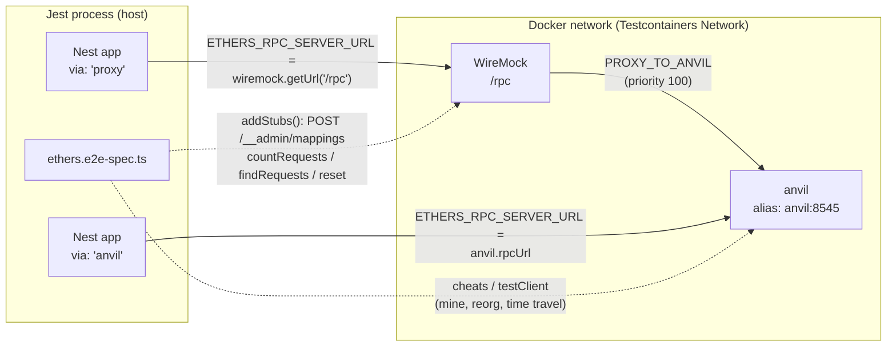
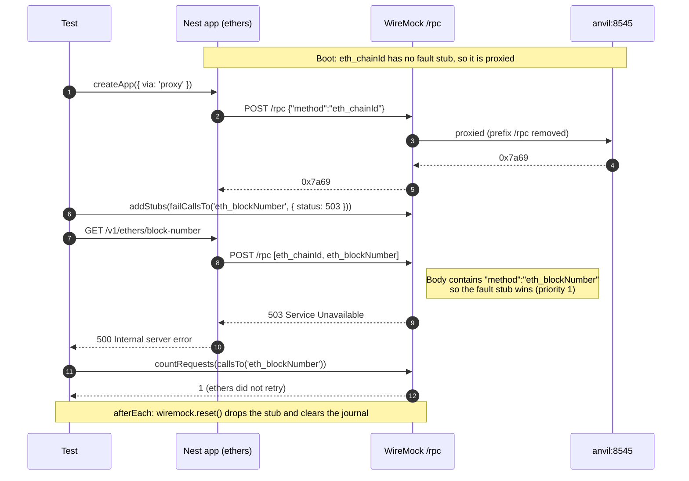

## Your RPC Provider Will Go Down. Will Your App?

Every Ethereum app depends on a JSON-RPC endpoint it doesn't control. Infura, Alchemy, QuickNode or your own node: at some point one of them sends back a `503`, drops a socket halfway through a response, slows to a crawl during a gas spike, or rate-limits you with a `429` at the worst possible moment.

Most teams test for this in one of two ways, and both are bad:

1. **They don't.** The happy path runs against a local node, and the first real outage is found in production.
2. **They hand-write JSON-RPC mocks.** Someone pastes a `eth_getBlockByNumber` response into a fixture, then another, then a batch array, then a mock for `eth_estimateGas`. Six months later the fixtures no longer match what a real node returns, and the tests pass while the app is broken.

This article shows a third way: **real chain state from a real EVM node, with network-level chaos injected on the wire.** We'll put [WireMock](https://wiremock.org/) in front of a [Foundry Anvil](https://getfoundry.sh/anvil/overview) node, both running as Docker containers through [Testcontainers](https://testcontainers.com/), and use it to test how a Nest.js + [ethers v6](https://docs.ethers.org/v6/) backend behaves when its RPC provider breaks.

Everything here comes from a working, open-source test suite: [`test/ethers.e2e-spec.ts`](https://github.com/anataliocs/nestjs-typeorm-full-example/blob/main/test/ethers.e2e-spec.ts) in the [nestjs-typeorm-full-example](https://github.com/anataliocs/nestjs-typeorm-full-example) repo, with the full design notes in [`test/test-setup.md`](https://github.com/anataliocs/nestjs-typeorm-full-example/blob/main/test/test-setup.md).

<Callout type="tip">
  New to running Anvil in tests? Start with our guide to [Solidity lifecycle testing with Foundry
  Anvil Testcontainers](/solidity-lifecycle-testing-foundry-anvil/), then come back here to break
  things on purpose.
</Callout>

---

<IconDivider icon="fa6-solid:triangle-exclamation" />

## Why a Local Node Alone Isn't Enough

Anvil is an excellent test oracle. It runs real EVM execution, real gas accounting and real state, and it gives you cheat codes for mining, time travel, reorgs and rollbacks. If your test asks "what is the finalized block after a one-block reorg?", Anvil gives you the true answer.

What Anvil can't do is **fail like a hosted provider fails**. It won't send you:

- an HTTP `503 Service Unavailable`
- a connection reset in the middle of a response
- an empty response or a truncated JSON body
- 1.5 seconds of latency on one specific method
- a `429 Too Many Requests` that clears up after one retry

Those failures happen at the HTTP transport layer, between your app and the node. To test them you need something sitting **on the wire**, not a mock inside your JavaScript process. Client-side mocks (stubbing `provider.getBlockNumber()` in Jest) skip the very code you want to test: ethers' HTTP transport, its batching, its retry logic and its error mapping.

---

<IconDivider icon="fa6-solid:diagram-project" />

## The Architecture: WireMock as a Fault-Injecting Reverse Proxy

The idea is simple. WireMock sits between the app and Anvil. **By default it forwards every JSON-RPC request unchanged, so Anvil produces every response.** WireMock never fakes chain data; it only injects faults, and only when a test asks it to.



The spec can boot the app two ways:

- **Direct** (`createApp()`): the app's ethers provider points straight at `anvil.rpcUrl`. Used for chain-behavior tests.
- **Proxied** (`createApp({ via: 'proxy' })`): the provider points at `wiremock.getUrl('/rpc')`. Used for transport-failure tests.

Either way, the test drives the chain through the Anvil test client and uses the node itself as the source of truth for expected values.

<FeatureGrid>
  <FeatureCard title="Zero EVM imitation" icon="fa6-brands:ethereum" bordered>
    Anvil handles state, gas and execution. You never maintain brittle fixtures for `eth_call` or
    `eth_estimateGas`.
  </FeatureCard>
  <FeatureCard title="Surgical fault injection" icon="fa6-solid:wand-magic-sparkles" bordered>
    A high-priority stub breaks one JSON-RPC method. Every other call still reaches the real node.
  </FeatureCard>
  <FeatureCard title="True network-level chaos" icon="fa6-solid:network-wired" bordered>
    503s, connection resets, malformed JSON and latency hit ethers' real HTTP transport.
  </FeatureCard>
  <FeatureCard title="Clean assertion separation" icon="fa6-solid:list" bordered>
    WireMock's request journal checks client behavior (retries, payloads). Anvil checks chain state.
  </FeatureCard>
</FeatureGrid>

---

<IconDivider icon="fa6-brands:docker" />

## Step 1: Put Anvil and WireMock on One Docker Network

Both containers come from Hella Labs' open-source Testcontainers modules:

- [`@hellaweb3/foundryanvil-testcontainers-nodejs`](https://www.npmjs.com/package/@hellaweb3/foundryanvil-testcontainers-nodejs) ([GitHub](https://github.com/hella-labs/foundryanvil-testcontainers-nodejs), [project page](/open-source/foundry-anvil-testcontainers/))
- [`@hellaweb3/wiremock-testcontainers-nodejs`](https://www.npmjs.com/package/@hellaweb3/wiremock-testcontainers-nodejs) ([GitHub](https://github.com/hella-labs/wiremock-testcontainers-nodejs), [project page](/open-source/wiremock-testcontainers/))

`useAnvil()` manages one Anvil node per test file. It starts it in `beforeAll`, restores a snapshot after every test, and stops it in `afterAll`. Its `start()` hook creates a [Testcontainers `Network`](https://node.testcontainers.org/features/networking/) and gives Anvil the alias `anvil`:

```ts
const anvil = useAnvil({
  start: async () => {
    network = await new Network().start();
    return new AnvilContainer(
      new AnvilOptions().account
        .withAccounts(3)
        .state.withTimestamp(GENESIS) // deterministic block dates
        .mining.withSlotsInAnEpoch(1) // finalized = head − 2
        .logs.jsonLogFormat(),
    )
      .withTestClient((client) => client.withAccount(0))
      .withNetwork(network)
      .withNetworkAliases(ANVIL_ALIAS) // "anvil"
      .start();
  },
});
```

WireMock joins the same network, so from inside WireMock, Anvil is reachable at `http://anvil:8545`. Your test process on the host still talks to each container through its mapped port:

```ts
wiremock = await new WiremockContainer()
  .withNetwork(network)
  .withMapping("json-rpc/proxy-to-anvil", { json: PROXY_TO_ANVIL })
  .start();
await wiremock.waitUntilReady();
```

<Callout type="warning">
  Keep Testcontainers versions aligned. Both `@hellaweb3/*` libraries depend on
  `testcontainers@^12`. If your project's `testcontainers` or `@testcontainers/postgresql` is on a
  different major version, a `Network` from one copy can't be passed to containers from the other.
</Callout>

---

<IconDivider icon="fa6-solid:code-branch" />

## Step 2: A Transparent, Low-Priority Proxy Stub

The baseline stub matches everything under `/rpc` and forwards it to Anvil. It's registered at **priority 100**, which in WireMock means low priority (lower numbers win):

```ts
export const RPC_PATH = "/rpc";
export const ANVIL_ALIAS = "anvil";

export const PROXY_TO_ANVIL: WiremockStubMapping = {
  priority: 100,
  request: { method: "ANY", urlPath: RPC_PATH },
  response: {
    proxyBaseUrl: `http://${ANVIL_ALIAS}:8545`,
    proxyUrlPrefixToRemove: RPC_PATH,
  },
};
```

With no other stubs registered, the app sees Anvil exactly as if it were connected directly. The first proxied test proves that: it mines seven blocks, reads the head and the finalized block through WireMock, and checks both against Anvil:

```ts
it("is transparent: real anvil data, one RPC call per request", async () => {
  await anvil.mine(7);
  const finalized = await blockAt(BigInt(7 - FINALITY_LAG));
  const app = await createApp({ via: "proxy" });
  await wiremock.resetRequests(); // ignore start-up network detection

  await request(app.getHttpServer())
    .get("/v1/ethers/block-number")
    .expect(200)
    .expect({ blockNumber: 7 });
  // ...finalized-block check against `finalized.hash`...

  expect(await wiremock.countRequests(callsTo("eth_blockNumber"))).toBe(1);
  const calls = await recordedRpcCalls(wiremock);
  expect(calls.filter((c) => c.method === "eth_getBlockByNumber").map((c) => c.params)).toEqual([
    ["finalized", false],
  ]);
});
```

There's no fixture anywhere in that test. The expected values come from the chain.

Read more about how WireMock picks a stub in the [stub priority docs](https://wiremock.org/docs/stubbing/#stub-priority) and about forwarding in the [proxying docs](https://wiremock.org/docs/proxying/).

---

<IconDivider icon="fa6-solid:wrench" />

## Step 3: Inject Faults Per Method at Runtime

Every JSON-RPC request is a `POST` to the same path, so you can't route faults by URL. Instead, a fault stub matches on the **request body**. Two small helpers do all the work:

```ts
/** Requests carrying a call to `method`, alone or inside a batch. */
export function callsTo(method: string): WiremockRequestCriteria {
  return {
    method: "POST",
    urlPath: RPC_PATH,
    bodyPatterns: [{ contains: `"method":"${method}"` }],
  };
}

/** A priority-1 stub that overrides every request calling `method`. */
export function failCallsTo(
  method: string,
  response: object,
  extra: Record<string, unknown> = {},
): WiremockStubMapping {
  return { priority: 1, request: callsTo(method), response, ...extra };
}
```

`addStubs()` POSTs these to WireMock's [admin API](https://wiremock.org/docs/standalone/admin-api-reference/) mid-test. Because the fault stub is priority 1, it beats the proxy for that one method and nothing else.

Here's what one fault test looks like on the wire, from boot to cleanup:



From there, each failure mode is a few lines.

### HTTP 503: does the app fail cleanly, and does it retry?

```ts
it("fails with 500 and does not retry when the node returns 503", async () => {
  const app = await createApp({ via: "proxy" });
  await addStubs(
    wiremock,
    failCallsTo("eth_blockNumber", { status: 503, body: "Service Unavailable" }),
  );

  await request(app.getHttpServer())
    .get("/v1/ethers/block-number")
    .expect(500)
    .expect({ statusCode: 500, message: "Internal server error" });

  expect(await wiremock.countRequests(callsTo("eth_blockNumber"))).toBe(1);
});
```

The final assertion matters most. The journal shows that ethers sent the call **exactly once**. If you expected a retry policy, this test tells you that you don't have one.

### Dropped connections and empty responses

WireMock's [simulated faults](https://wiremock.org/docs/simulating-faults/) break the socket itself:

```ts
it.each(["CONNECTION_RESET_BY_PEER", "EMPTY_RESPONSE"])(
  "fails with 500 on a %s network fault",
  async (fault) => {
    const app = await createApp({ via: "proxy" });
    await addStubs(wiremock, failCallsTo("eth_blockNumber", { fault }));

    await request(app.getHttpServer()).get("/v1/ethers/block-number").expect(500);
  },
);
```

### A malformed JSON-RPC body, with the blast radius checked

```ts
await addStubs(
  wiremock,
  failCallsTo("eth_getBlockByNumber", {
    status: 200,
    headers: { "Content-Type": "application/json" },
    body: '{"jsonrpc":"2.0",',
  }),
);

await request(app.getHttpServer()).get("/v1/ethers/finalized-block").expect(500);
await request(app.getHttpServer())
  .get("/v1/ethers/block-number")
  .expect(200)
  .expect({ blockNumber: 2 }); // other routes unaffected
```

### Latency on top of real data

Spread the proxy response into the fault stub and add a delay. The app gets real Anvil data, just late:

```ts
await addStubs(
  wiremock,
  failCallsTo("eth_blockNumber", {
    ...PROXY_TO_ANVIL.response,
    fixedDelayMilliseconds: 1_500,
  }),
);
```

### Rate limiting that recovers

A [stateful scenario](https://wiremock.org/docs/stateful-behaviour/) returns a `429` once, then switches back to proxying:

```ts
await addStubs(
  wiremock,
  failCallsTo(
    "eth_blockNumber",
    { status: 429, body: "Too Many Requests" },
    {
      scenarioName: "rate-limit",
      requiredScenarioState: "Started",
      newScenarioState: "recovered",
    },
  ),
);

await request(app.getHttpServer())
  .get("/v1/ethers/block-number")
  .expect(200)
  .expect({ blockNumber: 6 });

expect(await wiremock.countRequests(callsTo("eth_blockNumber"))).toBe(2);
```

Two requests in the journal: ethers retried once after the `429` and got real data back.

### Partial outages

You can also fault several methods at once and check that health reporting tells the truth:

```ts
await addStubs(
  wiremock,
  failCallsTo("eth_blockNumber", { status: 503 }),
  failCallsTo("eth_getBlockByNumber", { status: 503 }),
);
const app = await createApp({ via: "proxy" });

await request(app.getHttpServer()).get("/v1/ethers/block-number").expect(500);
await request(app.getHttpServer()).get("/v1/ethers/server-status").expect(200).expect("Connected"); // is that really what you want your status page to say?
```

This is the kind of finding chaos testing exists for. The status endpoint reports `Connected` while every block call fails. Now it's a documented, tested behavior you can decide to change, not a surprise during an incident.

---

<IconDivider icon="fa6-solid:rotate" />

## Step 4: Strict Isolation Between Tests

Chaos tests are only useful if one test's chaos can't leak into the next. Two mechanisms handle that:

- **Chain state:** `useAnvil` restores an Anvil snapshot after every test, so mined blocks, reorgs and time travel never carry over.
- **Fault state:** `afterEach` closes every Nest app and calls `wiremock.reset()`. That removes runtime fault stubs (the proxy stub from `withMapping` stays), resets scenarios and clears the request journal.

```ts
afterEach(async () => {
  sockets.splice(0).forEach((socket) => socket.terminate());
  await Promise.all(apps.splice(0).map((app) => app.close()));
  await wiremock.reset(); // drop runtime fault stubs, clear the journal
});
```

---

<IconDivider icon="fa6-solid:lightbulb" />

## Gotchas We Hit (So You Don't Have To)

<CheckList>

- **ethers v6 batches requests.** After network detection, ethers sends an `eth_chainId` re-check
  in the same JSON array as most calls. Matching on `contains: '"method":"…"'` works for both single
  and batched bodies, because ethers serializes JSON without whitespace. A fault hits the whole
  batch, just as a real HTTP failure would. If you need stricter matching, WireMock's
  [`matchesJsonPath`](https://wiremock.org/docs/request-matching/#json-path) can do it, but your
  expression must handle both object and array payloads.
- **Never fault `eth_chainId` at boot.** The app calls `getNetwork()` on startup. If `eth_chainId`
  never succeeds, ethers retries network detection forever and the app never boots.
- **Boot traffic is in the journal.** Call `wiremock.resetRequests()` after `createApp()` when
  you assert on total call counts.
- **Preserve JSON-RPC ids in custom error bodies.** HTTP-level faults (503, resets) don't need
  an id. If you return a JSON-RPC `error` object instead, use [response
  templating](https://wiremock.org/docs/response-templating/) (`{{jsonPath request.body '$.id'}}`)
  so the client can match the error to its request.
- **Pin finality.** Anvil reports `finalized = max(0, head − 2 · slotsInAnEpoch)`. Setting
  `.mining.withSlotsInAnEpoch(1)` makes the finalized block lag the head by exactly two blocks.
- **WebSockets bypass WireMock.** WireMock proxies HTTP/HTTPS only. If your app uses
  `eth_subscribe` over `ws://`, those connections need to go straight to Anvil or be tested
  separately.

</CheckList>

---

<IconDivider icon="fa6-solid:flask" />

## Adding Your Own Fault Test

Once the helpers exist, a new failure scenario is about ten lines:

```ts
it("fails with 500 when eth_getBlockByNumber drops the connection", async () => {
  const app = await createApp({ via: "proxy" });
  await addStubs(
    wiremock,
    failCallsTo("eth_getBlockByNumber", { fault: "CONNECTION_RESET_BY_PEER" }),
  );

  await request(app.getHttpServer()).get("/v1/ethers/finalized-block").expect(500);

  expect(await wiremock.countRequests(callsTo("eth_getBlockByNumber"))).toBe(1);
});
```

Run the suite with Docker running:

```shell
pnpm test:e2e
```

The same suite also covers the app's REST, GraphQL, WebSocket and Server-Sent Events APIs against Anvil directly. For the streaming side of that backend, see [On-Chain Ethereum Data via WebSockets with Ethers.js, RxJS and Nest.js](/websocket-sse-graphql-nestjs-thinclient/).

---

<IconDivider icon="fa6-solid:book-open" />

## Resources

- **Example suite:** [anataliocs/nestjs-typeorm-full-example](https://github.com/anataliocs/nestjs-typeorm-full-example) ([`ethers.e2e-spec.ts`](https://github.com/anataliocs/nestjs-typeorm-full-example/blob/main/test/ethers.e2e-spec.ts), [`test-setup.md`](https://github.com/anataliocs/nestjs-typeorm-full-example/blob/main/test/test-setup.md))
- **Anvil Testcontainers:** [npm](https://www.npmjs.com/package/@hellaweb3/foundryanvil-testcontainers-nodejs) · [GitHub](https://github.com/hella-labs/foundryanvil-testcontainers-nodejs) · [Project overview](/open-source/foundry-anvil-testcontainers/)
- **WireMock Testcontainers:** [npm](https://www.npmjs.com/package/@hellaweb3/wiremock-testcontainers-nodejs) · [GitHub](https://github.com/hella-labs/wiremock-testcontainers-nodejs) · [Project overview](/open-source/wiremock-testcontainers/)
- **Docs:** [Foundry Anvil](https://getfoundry.sh/anvil/overview) · [WireMock](https://wiremock.org/docs/) · [Testcontainers for Node.js](https://node.testcontainers.org/) · [ethers v6](https://docs.ethers.org/v6/) · [NestJS testing](https://docs.nestjs.com/fundamentals/testing)

---

<IconDivider icon="fa6-solid:rocket" />

## How Hella Labs Can Help

We built these libraries because our clients kept finding RPC failures in production. If you'd rather have this running in your pipeline next sprint than build it yourself, here's what we do:

<FeatureGrid>
  <FeatureCard
    title="DevOps & Test Automation"
    icon="fa6-brands:github"
    bordered
    cta={{ label: "See the service", href: "/services/devops-test-automation/" }}
  >
    Chaos and end-to-end test suites built on Anvil and WireMock, wired into CI/CD so every pull
    request faces a simulated outage before your users do.
  </FeatureCard>
  <FeatureCard
    title="Web3 Tooling & SDKs"
    icon="fa6-solid:cubes"
    bordered
    cta={{ label: "See the service", href: "/services/web3-tooling-sdks/" }}
  >
    Resilient RPC clients, retry and fallback strategies, and developer SDKs designed around how
    providers actually fail.
  </FeatureCard>
  <FeatureCard
    title="Technical Articles"
    icon="fa6-solid:pen-to-square"
    bordered
    cta={{ label: "See the service", href: "/services/technical-articles/" }}
  >
    Deep-dive tutorials like this one, with working example code, written for your protocol's
    developer audience.
  </FeatureCard>
  <FeatureCard
    title="dApp Front-Ends"
    icon="fa6-solid:laptop-code"
    bordered
    cta={{ label: "See the service", href: "/services/dapp-web-front-end/" }}
  >
    Front-ends that degrade gracefully when the chain is slow or unreachable, instead of hanging on
    a spinner.
  </FeatureCard>
</FeatureGrid>

<CtaSection
  variant="banner"
  title="Find out how your app handles an outage, before your users do."
  button={{ label: "Book a Resilience Audit", href: "/contact/" }}
  link={{ label: "Explore All Service Offerings →", href: "/web3-consultant-service-offerings/" }}
>
  <p>
    In a short engagement we stand up an Anvil + WireMock chaos suite against <strong>your</strong>{" "}
    backend, run it through 503s, dropped connections, latency spikes and rate limits, and hand you
    a report of every failure mode we find, plus the tests that prove each fix.
  </p>
  <p>
    <strong>No fake JSON-RPC fixtures, no guesswork.</strong> Just real chain state, real failures
    and a CI pipeline that catches regressions for good.
  </p>
</CtaSection>

---

**Thanks for reading!** If this helped, star [WireMock Testcontainers](https://github.com/hella-labs/wiremock-testcontainers-nodejs) and [Foundry Anvil Testcontainers](https://github.com/hella-labs/foundryanvil-testcontainers-nodejs) on GitHub and share the article with your team.

_Part of the Hella Labs commitment to open-source excellence and Web3 infrastructure._
