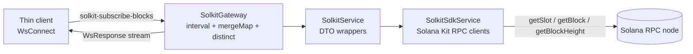

## On-Chain Solana Data via WebSockets with Solkit, RxJS and Nest.js

In [Part 1](/websocket-sse-graphql-nestjs-thinclient/) we wrapped [Ethers.js](https://docs.ethers.org/) in a reusable
[Nest.js](https://nestjs.com/) module and streamed finalized Ethereum blocks over
[WebSockets](https://developer.mozilla.org/en-US/docs/Web/API/WebSockets_API). In
[Part 2](/sse-graphql-ethereum-nestjs-thinclient/) we put Server-Sent Events and GraphQL in front of the same service
layer without touching it.

This time we **change the chain**. We swap Ethers.js for [Solana Kit](https://www.solanakit.com/) (`@solana/kit`,
"Solkit" in the example repo) and stream finalized **Solana** blocks to the same kind of ultra-thin browser client.

The point of this article is how little changes. The module shape, the service-layer wrappers, the RxJS pipeline in
the gateway and the front-end `WsConnect` class are all the same pattern as the Ethereum version. What's new is only the
part that _should_ be new: how Solana Kit talks to a Solana RPC node, and how Solana's data model differs from
Ethereum's.

<Callout type="note">

New to the series? Part 1 explains the layered design (SDK module → service → gateway → thin client) in detail. This
article focuses on what's different for Solana, so a quick skim of Part 1 first will help.

</Callout>

### What's Different About Solana

A few Solana concepts show up directly in the code, so they're worth knowing up front:

- **Slots vs. block height**: Solana produces a **slot** roughly every 400 ms, but not every slot produces a block.
  **Block height** counts only the blocks that were actually produced, so it's always lower than the slot number.
  RPC methods like `getBlock` take a **slot**; `getBlockHeight` returns a **height**.
- **Commitment levels**: every read can ask for `processed`, `confirmed` or `finalized` data. `finalized` means a
  supermajority of the cluster has rooted the block, and it won't be rolled back.
- **`bigint` everywhere**: Solana Kit returns slots, heights and timestamps as `bigint`, which `JSON.stringify()` can't
  serialize. The service layer converts them to strings before they go over the wire.
- **Fast blocks**: at ~400 ms per slot, a 5-second poll sees a new finalized block on every tick, so the stream is
  much busier than the Ethereum one (~12 s per block).

### Why Solana Kit

[Solana Kit](https://www.solanakit.com/) is the successor to `@solana/web3.js` 1.x. It's a full rewrite with a
functional, tree-shakable API:

- **Small, composable pieces**: you import functions like `createSolanaRpc()` instead of a large `Connection` class.
- **Strong typing per RPC method**: an `Rpc<GetBlockApi>` only exposes `getBlock`, and its return type follows the
  options you pass in.
- **Lazy requests**: RPC calls return a `PendingRpcRequest` that does nothing until you call `.send()`, so you can
  build a request in one place and run it in another.
- **Zero dependencies** and modern JS (native `bigint`, `fetch`, `AbortSignal`), which works well in Node and in the
  browser.

---

## Getting Started

You can follow along with the [GitHub Repo](https://github.com/anataliocs/nestjs-typeorm-full-example). The Solana
code lives in two folders next to the Ethereum ones:

- `src/solkitsdk/`: the reusable **SolkitSdk** module that wraps Solana Kit
- `src/solkit/`: the **SolkitService**, the WebSocket gateway, plus the REST, SSE and GraphQL entry points

<Callout type="tip">

Open this repo in a [GitHub Codespace Devcontainer](https://codespaces.new/anataliocs/nestjs-typeorm-full-example) to
follow along!

</Callout>

Set the Solana RPC endpoints in your `.env` file. Any Solana RPC provider works; a provider such as
[Helius](https://www.helius.dev/) gives you both an HTTPS and a WSS endpoint with an API key query parameter.

**.env excerpt**

```bash
SOLKIT_RPC_SERVER_URL=https://mainnet.helius-rpc.com
SOLKIT_WS_SERVER_URL=wss://mainnet.helius-rpc.com/
SOLKIT_RPC_PROVIDER_KEY_PREFIX=?api-key=
SOLKIT_RPC_API_KEY=<your-api-key>
```

Here's how the pieces fit together, from the browser down to the Solana cluster:



---

## Integrating Solana Kit

As with Ethers.js, we start by wrapping the library in a [Nest.js module](https://docs.nestjs.com/modules) that owns
its configuration and lifecycle.

### Solkit Sdk Config

**Full example:**
[solkitSdkConfig.ts](https://github.com/anataliocs/nestjs-typeorm-full-example/blob/main/src/solkitsdk/solkitSdkConfig.ts)

The config interface is a little bigger than the Ethers one. Solana Kit uses **separate** clients for HTTP requests
and WebSocket subscriptions, so it takes two URLs, plus a prefix that tells the SDK how to attach the API key.

**solkitSdkConfig.ts**

```typescript
export interface SolkitSdkConfig {
  // RPC URL used to connect to the blockchain
  rpcServerUrl: string;
  // WSS URL used to subscribe to the blockchain
  wsServerUrl: string;
  network: string;
  // e.g. "?api-key=" for providers that take the key as a query parameter
  providerKeyPrefix: string;
}
```

### Solkit Sdk Module Definition

**Full example:**
[solkitSdk.module.ts](https://github.com/anataliocs/nestjs-typeorm-full-example/blob/main/src/solkitsdk/solkitSdk.module.ts)

The module is the same [dynamic module](https://docs.nestjs.com/fundamentals/dynamic-modules) pattern as
`EthersSdkModule`, with a `registerAsync()` function that builds the config at runtime and exports a single
`SolkitSdkService`.

**solkitSdk.module.ts**

```typescript
@Module({ imports: [ConfigModule] })
export class SolkitSdkModule {
  static registerAsync(options: SolkitSdkModuleAsyncOptions): DynamicModule {
    return {
      module: SolkitSdkModule,
      imports: [ConfigModule],
      providers: [
        {
          provide: CONFIG_OPTIONS,
          useFactory: options.useFactory,
          inject: [ConfigService],
        },
        SolkitSdkService,
      ],
      exports: [SolkitSdkService],
    };
  }
}
```

Put it next to `EthersSdkModule` and the only differences are the class names. That's the reusable part of the
pattern: adding a chain means adding a module with the same shape.

### Solkit Sdk Service

**Full example:**
[solkit.sdk.service.ts](https://github.com/anataliocs/nestjs-typeorm-full-example/blob/main/src/solkitsdk/solkit.sdk.service.ts)

The SDK service extends the same `SdkServiceBase<T>` as the Ethers version, which provides the connection status and
a guarded `rpcServer` getter. The type parameter is what changes. Instead of one Ethers `Provider`, the
`SolanaRpcServer` type holds a few Solana Kit clients, each **narrowly typed** to the RPC methods it's used for.

**solkit.sdk.service.ts excerpt**

```typescript
export type SolanaRpcServer = {
  rpcBlockHeightApi: Rpc<SolanaRpcApi>;
  rpcGetBlockApi: Rpc<GetBlockApi>;
  rpcGetSlotApi: Rpc<GetSlotApi>;
  rpcSubscriptions: RpcSubscriptions<SolanaRpcSubscriptionsApi>;
};
```

`createSolanaRpc()` returns a client for the full `SolanaRpcApi`, so storing it as `Rpc<GetBlockApi>` simply limits
what the rest of the class can call on it. `createSolanaRpcSubscriptions()` creates the WebSocket subscriptions client
from the WSS URL.

The constructor reads the config, builds the URLs with the API key appended and creates the clients.

**solkit.sdk.service.ts constructor**

```typescript
@Injectable()
export class SolkitSdkService extends SdkServiceBase<SolanaRpcServer> implements SdkService {
  private readonly logger: Logger = new Logger(SolkitSdkService.name);

  private readonly rpcServerUrl: string;
  private readonly wsServerUrl: string;
  private readonly providerKeyPrefix: string;
  private readonly network: string;

  constructor(
    private configService: ConfigService,
    @Inject(CONFIG_OPTIONS) private options: SolkitSdkConfig,
  ) {
    super(`Solana Kit SDK Rpc Server is not initialized.`);
    this.rpcServerUrl = options.rpcServerUrl || "";
    this.wsServerUrl = options.wsServerUrl || "";
    this.providerKeyPrefix = options.providerKeyPrefix || "";
    this.network = options.network;

    this._rpcServer = {
      rpcBlockHeightApi: createSolanaRpc(this.rpcServerUrl + this.apiKeyString()),
      rpcGetBlockApi: createSolanaRpc(this.rpcServerUrl + this.apiKeyString(), {}),
      rpcGetSlotApi: createSolanaRpc(this.rpcServerUrl + this.apiKeyString()),
      rpcSubscriptions: createSolanaRpcSubscriptions(this.wsServerUrl + this.apiKeyString()),
    } as SolanaRpcServer;
  }

  private apiKeyString() {
    return (
      (this.providerKeyPrefix || "") + (this.configService.get<string>("SOLKIT_RPC_API_KEY") || "")
    );
  }

  // ...
}
```

<Callout type="tip">

Unlike the Ethers service, empty values fall back to `""`, so running against a local node with no API key and no
prefix just works: the URL is used as-is.

</Callout>

### Solkit Sdk Service Functions

The SDK functions show off Solana Kit's **lazy request** model. Each RPC method builds a `PendingRpcRequest`, and
nothing goes over the network until something calls `.send()`.

`getBlockNumber()` returns the pending request itself and leaves sending to the caller.

**solkit.sdk.service.ts excerpt**

```typescript
export class SolkitSdkService extends SdkServiceBase<SolanaRpcServer> implements SdkService {
  // ...
  getBlockNumber(): PendingRpcRequest<bigint> {
    return this._rpcServer.rpcBlockHeightApi.getBlockHeight({
      commitment: "finalized",
    });
  }

  // ...
}
```

Getting the latest finalized block takes **two** calls on Solana. There's no "give me the finalized block" shortcut
like Ethers' `getBlock("finalized")`, so we first ask for the latest finalized **slot**, then fetch the block in that
slot.

**solkit.sdk.service.ts excerpt**

```typescript
export class SolkitSdkService extends SdkServiceBase<SolanaRpcServer> implements SdkService {
  // ...
  async getFinalizedBlock() {
    const finalizedSlot: bigint = await this._rpcServer.rpcGetSlotApi
      .getSlot({ commitment: "finalized" })
      .send();

    return this._rpcServer.rpcGetBlockApi.getBlock(finalizedSlot, {
      commitment: "finalized",
      maxSupportedTransactionVersion: 0,
    });
  }

  // ...
}
```

<Callout type="important">

`maxSupportedTransactionVersion: 0` is required on mainnet. Without it, the RPC node returns an error for any block
that contains a **versioned (v0) transaction**, which is nearly every block today.

</Callout>

`getBlockByNumber()` (used by the REST and GraphQL entry points) sends the request itself and returns a `Promise`.
Note the `BigInt(blockNumber)`: the argument arrives as a string from the API layer, and Solana Kit expects a `bigint`
slot.

**solkit.sdk.service.ts excerpt**

```typescript
export class SolkitSdkService extends SdkServiceBase<SolanaRpcServer> implements SdkService {
  // ...
  getBlockByNumber(blockNumber: string) {
    return this._rpcServer.rpcGetBlockApi
      .getBlock(BigInt(blockNumber), {
        maxSupportedTransactionVersion: 0,
      })
      .send();
  }

  // ...
}
```

### Solkit Sdk Service Lifecycle Hooks

The same [lifecycle hooks](https://docs.nestjs.com/fundamentals/lifecycle-events) from `SdkService` mark the client as
connected on startup and disconnected on shutdown.

**solkit.sdk.service.ts excerpt**

```typescript
export class SolkitSdkService extends SdkServiceBase<SolanaRpcServer> implements SdkService {
  // ...
  onModuleInit() {
    this.connected();
    this.logger.log(
      `Solana Kit SDK Rpc Server Status: ${this._rpcServerStatus} - RPC Server URL: ${this.rpcServerUrl}`,
    );
  }

  onApplicationShutdown(_signal?: string) {
    this.disconnected();
    this.logger.log(`Closing Solana Kit SDK Rpc Server Connection: ${_signal}`);
  }
}
```

<Callout type="tip">

Solana Kit clients connect lazily, so `onModuleInit()` doesn't make a network call. To fail fast on a bad URL or API
key, make `onModuleInit()` `async` and `await` a cheap call such as `getSlot().send()` before calling `connected()`,
the way the Ethers service awaits `getNetwork()`.

</Callout>

### Solkit Sdk Service Configuration

`registerAsync()` wires the module to environment variables through `ConfigService`, right next to the Ethers module
in `app.module.ts`.

**app.module.ts excerpt**

```typescript
SolkitSdkModule.registerAsync({
  imports: [ConfigModule],
  useFactory: (configService: ConfigService) =>
    ({
      network: "Mainnet",
      rpcServerUrl: configService.get<string>("SOLKIT_RPC_SERVER_URL"),
      wsServerUrl: configService.get<string>("SOLKIT_WS_SERVER_URL"),
      providerKeyPrefix: configService.get<string>("SOLKIT_RPC_PROVIDER_KEY_PREFIX"),
    }) as SolkitSdkConfig,
  inject: [ConfigService],
});
```

---

## Using the SolkitSdk Module

**Full example:**
[solkit.service.ts](https://github.com/anataliocs/nestjs-typeorm-full-example/blob/main/src/solkit/solkit.service.ts)

The **SolkitService** plays the same role as **EthersService**: it calls the SDK and turns raw Solana Kit results into
small, JSON-friendly DTOs that every transport can share.

### Solkit Service Constructor

**solkit.service.ts excerpt**

```typescript
@Injectable()
export class SolkitService {
  private readonly logger = new Logger(SolkitService.name);

  constructor(private readonly solkitSdkService: SolkitSdkService) {}

  // ...
}
```

### Solana DTOs

The DTOs mirror the Ethereum ones, with one difference: `blockNumber` is a **string**. Solana Kit hands back `bigint`
values, and a string keeps the full precision while staying JSON-safe.

**dto/solana-finalized-block.ts**

```typescript
export class SolanaFinalizedBlock {
  blockNumber: string;
  date?: string;
  hash?: string;
}
```

**dto/solana-block-number.ts**

```typescript
export class SolanaBlockNumber {
  blockNumber: string;
}
```

### Solkit Service \_getBlockNumberJson Function

This is where the lazy `PendingRpcRequest` from `getBlockNumber()` is finally sent. The `bigint` result is converted
with `toString()` into a `SolanaBlockNumber`.

**solkit.service.ts excerpt**

```typescript
export class SolkitService {
  // ...
  private readonly _getBlockNumberJson: () => Promise<SolanaBlockNumber> =
    async (): Promise<SolanaBlockNumber> =>
      ({
        blockNumber: (await this.solkitSdkService.getBlockNumber().send()).toString(),
      }) as SolanaBlockNumber;

  // ...
}
```

### Solkit Service \_getFinalizedBlocksJson Function

`_getFinalizedBlocksJson()` awaits the slot lookup, sends the `getBlock` request and maps the result to a
`SolanaFinalizedBlock`. Two things differ from the Ethers version:

- A missing block **throws** a `NotFoundException` instead of returning an empty object.
- Solana's `blockTime` is a Unix timestamp in **seconds** (a `bigint`), so `getCreationDateIso()` converts it to an
  ISO 8601 string.

**solkit.service.ts excerpt**

```typescript
export class SolkitService {
  // ...
  private readonly _getFinalizedBlocksJson: () => Promise<SolanaFinalizedBlock> =
    async (): Promise<SolanaFinalizedBlock> => {
      const finalizedBlock = await (await this.solkitSdkService.getFinalizedBlock()).send();

      if (finalizedBlock === null) {
        throw new NotFoundException(`Latest finalized block not found.`);
      }

      return {
        blockNumber: finalizedBlock.blockHeight?.toString() ?? "0",
        date: this.getCreationDateIso(finalizedBlock.blockTime),
        hash: String(finalizedBlock.blockhash ?? ""),
      } as SolanaFinalizedBlock;
    };

  private getCreationDateIso(solkitBlockTime: UnixTimestamp) {
    return solkitBlockTime != null
      ? new Date(Number(solkitBlockTime) * 1000).toISOString()
      : new Date(0).toISOString();
  }

  // ...
}
```

Note the double `await`: the first resolves `getFinalizedBlock()` (which already sent the `getSlot` request), and the
second sends the `getBlock` request it returned.

### Solkit Service finalizedBlocksStreamForWebsocket Function

This is the line-for-line twin of the Ethers version. The `_getFinalizedBlocksJson()` arrow function is passed to the
**shared** `buildWsResponse()` helper from Part 1, and `from()` turns the resulting `Promise` into an **Observable**.

**solkit.service.ts excerpt**

```typescript
export class SolkitService {
  // ...
  finalizedBlocksStreamForWebsocket(): (n: number) => Observable<WsResponse<SolanaFinalizedBlock>> {
    return (n: number): Observable<WsResponse<SolanaFinalizedBlock>> =>
      from(buildWsResponse<SolanaFinalizedBlock>(n, this._getFinalizedBlocksJson));
  }

  newBlocksStreamForWebsocket(): (n: number) => Observable<WsResponse<SolanaBlockNumber>> {
    return (n: number): Observable<WsResponse<SolanaBlockNumber>> =>
      from(buildWsResponse<SolanaBlockNumber>(n, this._getBlockNumberJson));
  }

  // ...
}
```

`buildWsResponse()` lives in `src/common/message-utils.ts` and is generic over the data type, so it serves Ethereum
and Solana alike with no changes. The same service also exposes `subscribeToFinalizedBlocksForSse()` and
`getBlockByNumberForGraphQL()`, so everything from [Part 2](/sse-graphql-ethereum-nestjs-thinclient/) works for Solana
too.

---

## Websocket Gateway

**Full example:**
[solkit.gateway.ts](https://github.com/anataliocs/nestjs-typeorm-full-example/blob/main/src/solkit/solkit.gateway.ts)

### Websocket Gateway Definition

The **SolkitGateway** implements the three gateway lifecycle interfaces so it can log initialization, connections and
disconnects.

**solkit.gateway.ts excerpt**

```typescript
@WebSocketGateway({ cors: { origin: "*" } })
export class SolkitGateway implements OnGatewayInit, OnGatewayConnection, OnGatewayDisconnect {
  private readonly logger = new Logger(SolkitGateway.name);

  @WebSocketServer() server: Server;

  constructor(private readonly solkitService: SolkitService) {}

  // ...
}
```

<Callout type="note">

Unlike `EthersGateway`, which listens on its own port (`81`), `@WebSocketGateway()` here has **no port**, so it attaches
to the main Nest.js HTTP server on port `3000`. One port for REST, SSE, GraphQL and WebSockets is simpler to deploy
behind a single load balancer or reverse proxy.

</Callout>

<Callout type="warning">

`cors: { origin: "*" }` is fine for a local demo. In production, list the exact origins your clients are served from.

</Callout>

### Websocket Gateway Event Listener

`onEvent()` listens for messages with `event: "solkit-subscribe-blocks"`. Just like the Ethers gateway, it validates
the payload against the shared `WebSocketSubscribeDto`, then picks a stream based on the `topic`. An unknown topic gets
a single error message back from `errorMsgWsResponse()`.

**solkit.gateway.ts excerpt**

```typescript
export class SolkitGateway implements OnGatewayInit, OnGatewayConnection, OnGatewayDisconnect {
  // ...
  @SubscribeMessage("solkit-subscribe-blocks")
  onEvent(
    @MessageBody(new ValidationPipe()) payload: WebSocketSubscribeDto,
    @ConnectedSocket() _client: WebSocket,
  ): Observable<WsResponse<SolanaBlockNumber | SolanaFinalizedBlock | WsError>> {
    this.logger.log(
      `Event: solkit-subscribe-blocks Client: ${payload.client} Topic: ${payload.topic}`,
    );

    switch (payload.topic) {
      case "block-number":
        return this.newBlocksStream();
      case "finalized-blocks":
        return this.finalizedBlocksStream();
      default:
        return errorMsgWsResponse(payload);
    }
  }

  // ...
}
```

Because the event name is different (`solkit-subscribe-blocks` vs. `ethers-subscribe-blocks`), one client can hold
subscriptions to both chains at once, and the topics (`block-number`, `finalized-blocks`) stay the same across chains.

### Websocket Gateway finalizedBlocksStream

The RxJS pipeline is identical to Part 1:

- `interval(5000)` ticks every 5 seconds
- `mergeMap()` calls the service on each tick and flattens the resulting Observable into the stream
- `distinct()` drops any block number that has already been sent

**solkit.gateway.ts excerpt**

```typescript
export class SolkitGateway implements OnGatewayInit, OnGatewayConnection, OnGatewayDisconnect {
  // ...
  private finalizedBlocksStream() {
    return interval(5000)
      .pipe(mergeMap(this.solkitService.finalizedBlocksStreamForWebsocket()))
      .pipe(distinct(({ data }) => data.blockNumber));
  }

  private newBlocksStream() {
    return interval(5000)
      .pipe(mergeMap(this.solkitService.newBlocksStreamForWebsocket()))
      .pipe(distinct(({ data }) => data.blockNumber));
  }

  // ...
}
```

### Websocket Gateway Lifecycle Hooks

`handleConnection()` receives the raw Node.js `IncomingMessage` as its second argument, which is handy for logging the
upgrade request's headers (or, in production, checking an auth token before accepting the socket).

**solkit.gateway.ts excerpt**

```typescript
export class SolkitGateway implements OnGatewayInit, OnGatewayConnection, OnGatewayDisconnect {
  // ...
  handleConnection(client: any, ..._args: any[]) {
    const argsString = (_args[0] as IncomingMessage).rawHeaders.join(" ");
    this.logger.log(`Connected Websocket: ${argsString}`);
  }

  handleDisconnect(_client: any) {
    this.logger.log(`Received Websocket Disconnect`);
  }

  afterInit(_server: Server) {
    this.logger.log(`WebSocket Gateway Initialized`);
  }
}
```

### Ethers vs. Solkit, Side by Side

| Layer         | Ethereum (Parts 1–2)                                                          | Solana (this article)                                |
| ------------- | ----------------------------------------------------------------------------- | ---------------------------------------------------- |
| SDK client    | One `JsonRpcProvider`                                                         | Several narrowly typed `Rpc<...>` clients            |
| Request model | Methods return a `Promise`                                                    | Methods return a `PendingRpcRequest`; call `.send()` |
| Finalized     | `getBlock("finalized")`                                                       | `getSlot({ commitment })` then `getBlock(slot)`      |
| Block number  | `number`                                                                      | `bigint`, sent to clients as a `string`              |
| Gateway port  | Dedicated port `81`                                                           | Shares the HTTP server on `3000`                     |
| Event name    | `ethers-subscribe-blocks`                                                     | `solkit-subscribe-blocks`                            |
| Shared code   | `buildWsResponse`, `WebSocketSubscribeDto`, `errorMsgWsResponse`, `WsConnect` | same                                                 |

---

## Front-end Client

The thin client is again a single `.html` file plus a small `.js` file, styled with [Pico CSS](https://picocss.com/)
and no build step. The only Solana-specific pieces are the endpoint, the event name and the block explorer link.

### Front-end Client - HTML

**Full example:**
[ws-sol-finalized-blocks.html](https://github.com/anataliocs/nestjs-typeorm-full-example/blob/main/client/src/ws/solkit/ws-sol-finalized-blocks.html)

**ws-sol-finalized-blocks.html excerpt**

```html
<div>
  <article>
    <strong>Emitted Events - Finalized Blocks</strong>
    <p>
      <ins id="connection-status"></ins>
    </p>
    <progress id="progress-bar"></progress>
    <article id="messages"></article>
  </article>
  <div role="group">
    <button
      id="send-message-button"
      title="Send websocket message to subscribe to Finalized Blocks"
    >
      Subscribe to Finalized Blocks
    </button>
    <button class="secondary" id="close-connection-button" title="Close websocket connection">
      Close Connection
    </button>
  </div>
</div>
```

The markup is the same as the Ethereum page, so the same `WsConnect` class can drive it.

### Front-end Client - Javascript

**Full example:**
[wsSolFinalizedBlock.js](https://github.com/anataliocs/nestjs-typeorm-full-example/blob/main/client/src/ws/solkit/js/wsSolFinalizedBlock.js)

The `WsConnect` object from Part 1 is reused as-is. We pass in:

- The Nest.js server on port `3000` (where the gateway is attached)
- The `solkit-subscribe-blocks` event name
- `createLinkSol`, which builds Solscan links instead of Etherscan ones

**wsSolFinalizedBlock.js**

```javascript
import { WsConnect } from "../../common/wsConnect.js";
import { createLinkSol } from "../../../../util/utils.js";

const websocket = new WsConnect("ws://localhost:3000", "solkit-subscribe-blocks", createLinkSol);

// Sending websocket message to the server
document.querySelector("#send-message-button").addEventListener("click", () => {
  console.log("Sending message to subscribe to finalized blocks");
  websocket.sendMessage("finalized-blocks");
});

// Close websocket connection
document.querySelector("#close-connection-button").addEventListener("click", () => {
  console.log("Closing finalized blocks websocket connection: User Requested");
  websocket.closeConnection("User Requested");
});
```

### Front-end Client - createLinkSol Function

**Full example:** [utils.js](https://github.com/anataliocs/nestjs-typeorm-full-example/blob/main/client/util/utils.js)

`createLinkSol()` has the same signature as `createLinkEth()`: it takes the block DTO and returns an `<a>` element.
That shared signature is what lets `WsConnect` stay chain-agnostic.

**utils.js excerpt**

```javascript
export function createLinkSol(block) {
  const link = document.createElement("a");
  link.href = `https://solscan.io/block/${block.blockNumber}`;
  link.text = `View Block ${block.blockNumber} on Solscan.io`;
  link.target = "_blank";
  link.title = "Open Block in Solscan.io";
  return link;
}
```

<Callout type="warning">

**Slot vs. block height gotcha:** Solscan's `/block/` URLs take a **slot**, but `blockNumber` in our DTO is the
**block height**. Because skipped slots don't produce blocks, the two numbers differ, and a height-based link opens
a different (older) block. If you want accurate explorer links, add the slot to the DTO (it's the `finalizedSlot` the
SDK service already looked up) and build the link from that.

</Callout>

---

## Taking the Solana Stream to Production

The demo is intentionally simple. Before you point real users at it, a few Solana-specific tweaks are worth making.

### Fetch Less Per Block

By default, `getBlock` returns **every transaction** in the block, and a mainnet block can hold well over a thousand.
The finalized-blocks stream only needs the height, hash and time, so ask the RPC node to leave the rest out:

**solkit.sdk.service.ts (suggested change)**

```typescript
return this._rpcServer.rpcGetBlockApi.getBlock(finalizedSlot, {
  commitment: "finalized",
  maxSupportedTransactionVersion: 0,
  transactionDetails: "none",
  rewards: false,
});
```

That cuts each poll's response from megabytes to a few hundred bytes. Keep the full response for
`getBlockByNumber()`, where the GraphQL model reports a `transactionCount`.

### Push Instead of Poll

Polling every 5 seconds skips roughly a dozen Solana slots per tick. The SDK service already creates an
`rpcSubscriptions` client from the WSS URL, and Solana Kit's subscriptions return an `AsyncIterable`, which RxJS's
`from()` accepts directly. A push-based stream could look like this:

**Sketch: slot notifications as an Observable**

```typescript
slotNotifications() {
  return defer(async () =>
    this._rpcServer.rpcSubscriptions.slotNotifications().subscribe({
      abortSignal: this.shutdownController.signal,
    }),
  ).pipe(mergeMap((notifications) => from(notifications)));
}
```

`defer()` waits to open the subscription until a client subscribes, and the `AbortSignal` (here, an
`AbortController` you'd abort in `onApplicationShutdown()`) closes it cleanly. The gateway's `interval()` is then
replaced by this stream, and the rest of the pipeline stays the same.

<Callout type="important">

**The same long-lived stream notes from Part 2 apply here, with more urgency on Solana's faster chain:**

- `distinct()` remembers every block number it has seen, so a stream open for days grows without bound. Use
  `distinctUntilChanged()` for the same result in constant memory.
- Each client gets its own interval and its own RPC calls. `share()` one upstream stream across all subscribers to keep
  your RPC bill (and rate limits) under control.

</Callout>

---

## Testing the Solana Stream

Because the SDK sits behind its own Nest.js provider, you can test the service and gateway without touching a real
Solana cluster. Swap `SolkitSdkService` for a mock that returns objects with a `send()` method, just like a
`PendingRpcRequest`:

**solkit.gateway.spec.ts (example)**

```typescript
import { Test } from "@nestjs/testing";
import { firstValueFrom } from "rxjs";
import { SolkitGateway } from "./solkit.gateway";
import { SolkitService } from "./solkit.service";
import { SolkitSdkService } from "../solkitsdk/solkit.sdk.service";

const pending = <T>(value: T) => ({ send: () => Promise.resolve(value) });

describe("SolkitGateway", () => {
  let gateway: SolkitGateway;

  beforeEach(async () => {
    const moduleRef = await Test.createTestingModule({
      providers: [
        SolkitGateway,
        SolkitService,
        {
          provide: SolkitSdkService,
          useValue: {
            getBlockNumber: () => pending(250_000_000n),
            getFinalizedBlock: async () =>
              pending({
                blockHeight: 250_000_000n,
                blockTime: 1_700_000_000n,
                blockhash: "8xK...Qm",
              }),
          },
        },
      ],
    }).compile();

    gateway = moduleRef.get(SolkitGateway);
  });

  it("streams finalized blocks as JSON-safe DTOs", async () => {
    const stream = gateway.onEvent(
      { client: "jest", topic: "finalized-blocks" },
      undefined as unknown as WebSocket,
    );

    const { data } = await firstValueFrom(stream);

    expect(data).toEqual({
      blockNumber: "250000000",
      date: "2023-11-14T22:13:20.000Z",
      hash: "8xK...Qm",
    });
  }, 10_000);

  it("rejects unknown topics", async () => {
    const stream = gateway.onEvent(
      { client: "jest", topic: "nope" },
      undefined as unknown as WebSocket,
    );

    expect(await firstValueFrom(stream)).toMatchObject({
      event: "error",
      data: { message: "Invalid topic: nope" },
    });
  });
});
```

The first test waits for the 5-second `interval()` tick. To skip the wait, use Jest fake timers or RxJS's
[`TestScheduler`](https://rxjs.dev/guide/testing/marble-testing).

For end-to-end tests against a real chain, point `SOLKIT_RPC_SERVER_URL` and `SOLKIT_WS_SERVER_URL` at a local
[`solana-test-validator`](https://solana.com/docs/toolkit/local-validator) (HTTP on `8899`, WebSockets on `8900`),
the Solana counterpart of the Foundry Anvil node we used for Ethereum in Parts 1 and 2. Leave
`SOLKIT_RPC_PROVIDER_KEY_PREFIX` and `SOLKIT_RPC_API_KEY` empty, and the URLs are used as-is.

---

## Conclusion

Thanks for reading!

We added a second blockchain to the same Nest.js backend by following the pattern from
[Part 1](/websocket-sse-graphql-nestjs-thinclient/): a dynamic SDK module wrapping Solana Kit, a service that turns
raw RPC results into small DTOs, and a gateway that streams them with RxJS. The front end reused `WsConnect` unchanged
and only swapped the event name and explorer link.

### Some Key Takeaways to Consider

**Benefits:**

- **Chain-agnostic Plumbing**: `buildWsResponse()`, `WebSocketSubscribeDto`, the RxJS pipeline and `WsConnect` are
  shared by Ethereum and Solana
- **One Port, Many Transports**: the Solana gateway shares the HTTP server with REST, SSE and GraphQL
- **Thin Clients**: still no framework or client library on the front end, just the browser's `WebSocket`
- **Typed RPC**: Solana Kit's narrow `Rpc<...>` types and lazy `PendingRpcRequest`s make the SDK layer explicit and
  easy to mock

**Concepts:**

- **Slots vs. Block Height**: Solana RPC methods take slots; block height only counts produced blocks
- **Commitment Levels**: ask for `finalized` when a value must never be rolled back
- **JSON-safe DTOs**: convert `bigint` to strings at the service boundary, before any transport sees the data
- **Poll vs. Push**: `interval()` polling is simple; Solana Kit subscriptions plus RxJS `from()` give you a true
  push stream

<Callout type="tip">

**What should we cover next in the series?** Bitcoin with `bitcoinjs-lib`, Solana account and program subscriptions,
GraphQL subscriptions, or production hardening? [Tell us in the Disqus comments below](#comments) and we'll use your
votes to pick a future entry.

</Callout>

_Thanks again for reading!_

---

<CtaSection
  variant="banner"
  as="h2"
  title="Building a Multi-Chain dApp?"
  button={{ label: "Talk to Hella Labs", href: "/contact/" }}
  link={{ label: "Explore All Service Offerings →", href: "/web3-consultant-service-offerings/" }}
>
  <p>
    Whether you're streaming Solana and Ethereum data to a trading dashboard, indexing program
    events, or serving typed on-chain data to web, mobile and analytics clients,{" "}
    <strong>a modular, well-tested backend</strong> is what lets you add the next chain in days
    instead of months.
  </p>
  <p>
    We design and build Nest.js and Web3 backends, real-time APIs and the E2E test automation that
    keeps them reliable when your RPC provider isn't.
  </p>
</CtaSection>
