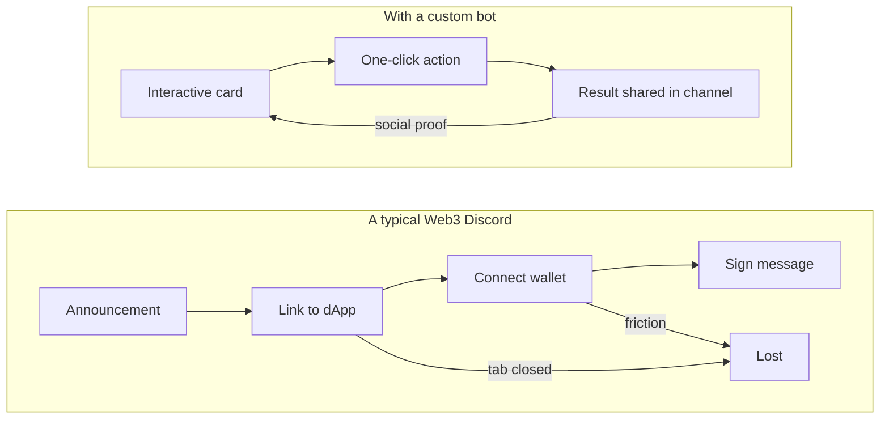
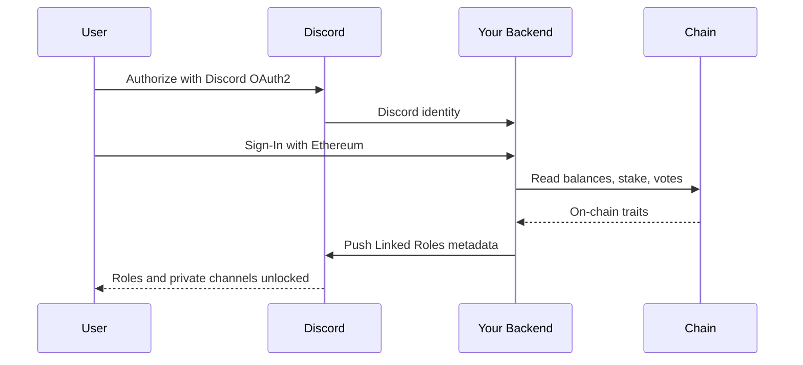
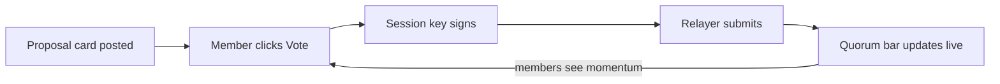
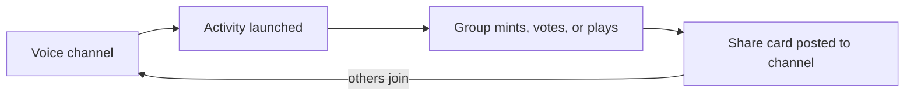
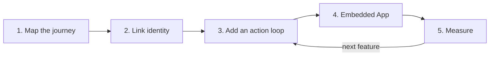

Discord is where your community already spends its time. For most Web3 projects, it's also where
the experience breaks apart. A user hears about a proposal in chat, leaves for a governance site,
connects a wallet, signs a message, and never makes it back to the conversation that brought them
there.

Most teams treat their Discord bot as a moderator: it bans spam, assigns a role, and posts
announcements. That leaves most of what the platform can do unused.

Discord's developer platform now supports **OAuth2 identity and Linked Roles**, rich interactive
**Components V2** messages, and full **Embedded Apps (Activities)** that run HTML5, WebGL, and
WebAssembly right inside the Discord client. Put together, they let your server act as part of
your product instead of a waiting room outside it.

The difference looks like this:

## Why Listen to Us

- **Inside the platforms.** Our engineers have shipped production code and supported developer
  ecosystems at **ConsenSys (Infura)**, **Stellar Development Foundation**, and **Uphold**, so we
  know how wallets, RPC providers, and on-chain data behave at scale.
- **In the community.** We run hands-on Discord and Telegram community management and have
  launched campaigns that turn lurkers into contributors. We build bots for the problems we've
  seen moderators and members struggle with.
- **In open source.** **945+ GitHub stars** across 200+ repositories. We're also building
  open-source Discord modules for Web3 authentication and gated access (see below).

## Three Layers of an On-Chain Discord Experience

| Layer                        | Discord capability                                                                                    | What it gives your community                                  |
| ---------------------------- | ----------------------------------------------------------------------------------------------------- | ------------------------------------------------------------- |
| **1. Identity & onboarding** | OAuth2 + Linked Roles                                                                                 | Verify once, get the right roles and channels automatically   |
| **2. In-chat action loops**  | [Components V2](https://docs.discord.com/developers/components/overview)                              | Vote, claim, and check positions without leaving the channel  |
| **3. Embedded apps**         | [Embedded App SDK (Activities)](https://docs.discord.com/developers/developer-tools/embedded-app-sdk) | Full dApps and multiplayer experiences running inside Discord |

### Layer 1: Frictionless Identity & Token-Gated Onboarding

**Goal:** Link a user's wallet to their Discord account once and keep it linked.

- **Persistent cross-platform reputation.** Pairing Discord OAuth2 with Sign-In with Ethereum
  (SIWE) or smart account session keys binds a user's on-chain identity to their Discord ID.
  Discord can also serve as the login for your own app, giving you one identity across both.
- **Automated metadata and Linked Roles.** Your backend pushes on-chain traits such as governance
  participation, staking tier, or verifiable credentials (DIDs) straight to Discord's Linked Roles
  metadata API.
- **Zero-friction verification.** Users prove asset ownership once and unlock server roles,
  private channels, and badges automatically, without re-signing a message on every visit.

### Layer 2: High-Signal, In-Chat Action Loops

**Goal:** Let users act where the conversation is happening.

- **Live governance and proposal feeds.** Instead of a plain link, the bot posts a structured
  Components V2 card with a media gallery (proposal visuals, token charts), a live quorum progress
  section, and **Vote For / Against** buttons.
- **Private portfolio and position dashboards.** A **Check Position** or **Claim Rewards** button
  opens an ephemeral (visible only to that user) layout tailored to their linked address, showing
  unclaimed yield, vesting schedules, or NFT traits without cluttering public channels.
- **Gasless actions and session keys.** With pre-authorized session keys or ERC-4337 gasless
  relayers, users can cast a vote, claim from a daily faucet, or tip a contributor with a single
  button click inside chat.

### Layer 3: Co-Located Multiplayer & dApp Execution

**Goal:** Bring your dApp into Discord so people use it together.

- **In-client dApp mini-apps.** An Embedded App opens your web dApp inside Discord, which suits
  portfolio trackers, NFT minting interfaces, DEX swap widgets, and DAO treasury dashboards. Voice
  and text chat stay active alongside it.
- **Social, multiplayer on-chain loops.** Activities can read who's in the voice channel, so you
  can build experiences people use together in real time:
  - **Live DAO town halls** with real-time quadratic voting, delegate Q&As, and instant POAP or
    badge claims for people in the call.
  - **Co-op on-chain games and auctions**, live NFT drops, or group bidding pools where friends
    see each other's avatars and reactions.
- **Viral distribution through chat moments.** Activities can post Components V2 share cards back
  into the channel ("Alice just minted Rare #402," "Guild raid boss defeated"), turning one
  person's action into social proof that pulls the rest of the group in.

## Putting It into Practice

1. **Map the journey.** Find where members leave Discord today: claims, votes, mints, support
   questions.
2. **Link identity first.** Ship OAuth2, SIWE, and Linked Roles so every later feature knows who
   it's talking to.
3. **Add one action loop.** Pick the single highest-traffic action and bring it into chat with
   Components V2.
4. **Graduate to an Activity.** When a workflow needs a full UI or works better as a group, move
   it into an Embedded App.
5. **Measure and iterate.** Track verifications, button clicks, and share-card engagement, then
   keep what moves the numbers.

## What We Offer

### Wallet Verification & Linked Roles

OAuth2 and SIWE onboarding, token- and credential-gated roles, and a backend that keeps Discord
in sync with on-chain state.

### Interactive Bots & Components V2

Governance feeds, reward claims, private dashboards, and gasless one-click actions built on
Discord's interactive components.

### Embedded Apps & Activities

Your dApp, game, or live event running inside Discord with HTML5, WebGL, or WebAssembly, wired to
the voice channel for multiplayer experiences.

### Hosting, Monitoring & Support

Production deployment, uptime monitoring, rate-limit handling, and ongoing updates as Discord's
platform and your protocol evolve.

## Open Source Projects

- **Coming Soon:** We're building several open-source Discord modules for Web3 authentication and
  gated community access. Follow our [GitHub](https://github.com/hella-labs) for updates.
