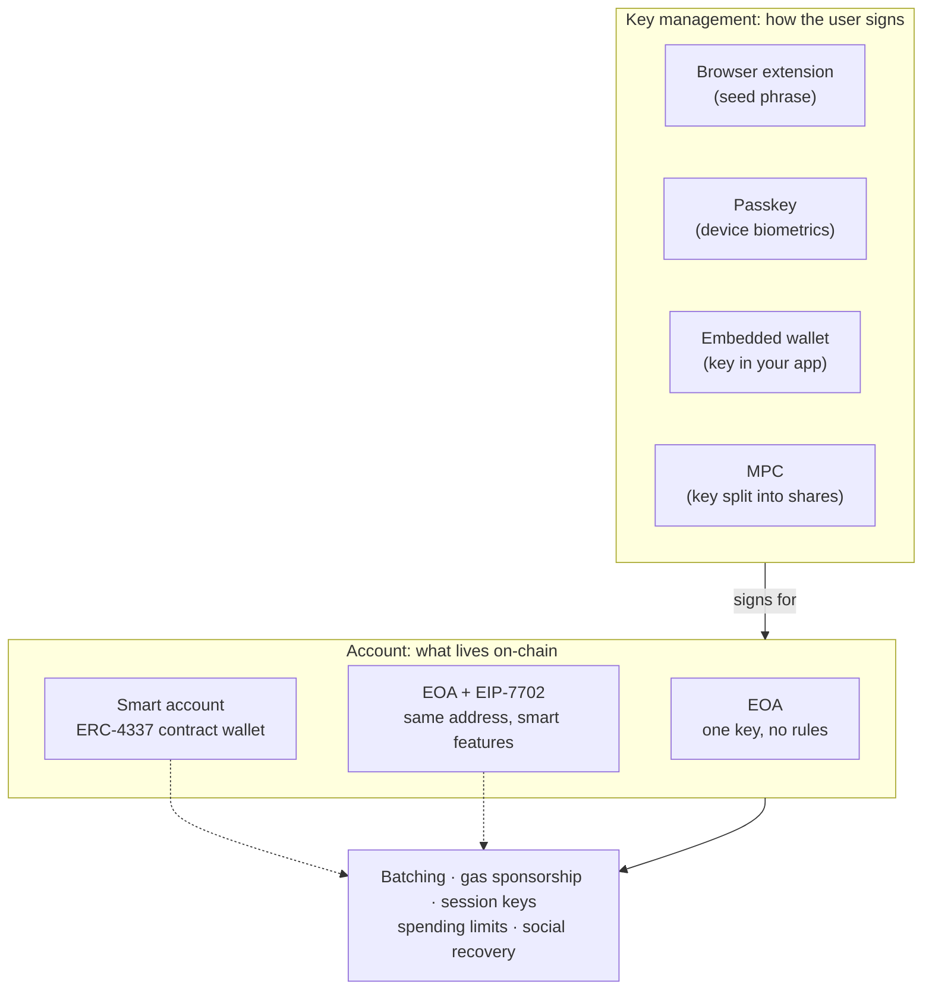
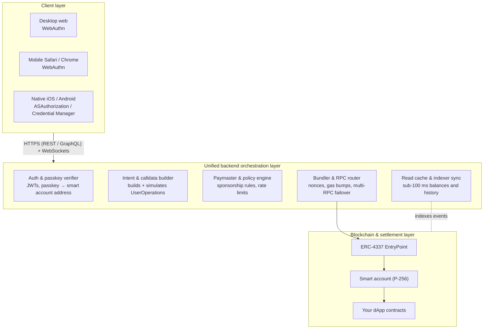
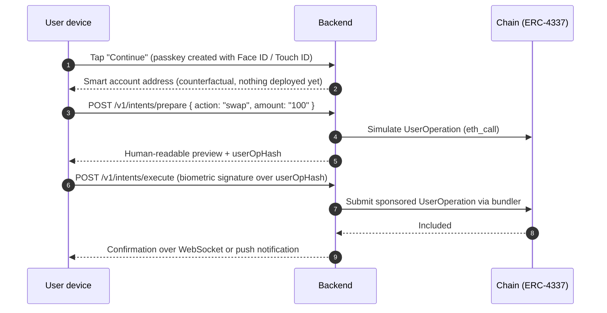

Most dApp teams spend nearly all of their energy on the Solidity smart contracts and treat the
front-end as an afterthought. It's often a starter template with a "Connect Wallet" button bolted
on, shipped the week before launch.

That's backwards. **The greatest smart contract in the world is useless if no one uses it**, and
the front-end is where users decide whether they will. Poor UX and slow load times are among the
biggest reasons dApps fail to get adopted, and they're entirely fixable.

## Why Listen to Us

We've spent years building large Web2 SaaS products, where every change to a signup flow is A/B
tested and every millisecond of load time shows up in revenue. That work makes it clear how
sensitive users are to friction:

- **Adding one or two input fields** to a form produced a **15–20% increase in drop-off** in A/B
  tests we ran.
- **Removing a single click** from a key flow **raised conversion by 10%**.

We bring that same discipline to Web3. Our engineers have shipped production code at
**ConsenSys (Infura)**, **Stellar Development Foundation**, and **Uphold**, so we know the protocol
side too. We also write openly about how we build fast dApps, like our deep dive on
[reactive, streaming dApp architecture](/websocket-sse-graphql-nestjs-thinclient/) with
WebSockets, Ethers.js, RxJS, and NestJS.

## Speed Is a Feature

Users are extremely sensitive to performance. Industry research shows how quickly a slow page
loses people:

| Load time      | Bounce probability (Google/SOASTA) | E-commerce conversion (Portent) | B2B / lead-gen conversion (Portent) |
| -------------- | ---------------------------------- | ------------------------------- | ----------------------------------- |
| **1 second**   | Baseline                           | 3.05%                           | ~39–40%                             |
| **2 seconds**  | —                                  | 1.68% (−45% relative)           | 34%                                 |
| **3 seconds**  | +32%                               | 1.12%                           | 29%                                 |
| **5 seconds**  | +90%                               | ~0.6–0.8%                       | ~13–15% (about 3× worse than 1s)    |
| **6+ seconds** | +106% (6s) to +123% (10s)          | Near the floor                  | ~50% lower than the 1–2s baseline   |

If your dApp is slow or confusing, users leave and don't come back. Typical dApps are both.

## Why Most dApps Lose Users Before the First Transaction

Traditional Web3 onboarding stacks every known conversion killer into one flow. It forces users
into desktop-only browser extensions, seed-phrase setup, and RPC-induced latency before they see
any value. The result is funnel abandonment of **95% to 99%+**.

<FeatureGrid>
  <FeatureCard icon="fa6-solid:laptop-code" title="The Mobile Lockout" as="h3" bordered>
    Around 60% of global web traffic is mobile, and mobile Safari and Chrome don't support browser
    extensions. Requiring MetaMask or Rabby excludes most of the internet. WalletConnect
    deep-linking to a separate wallet app and back often loses 50–75% of users to app-switching
    timeouts and broken sessions.
  </FeatureCard>
  <FeatureCard icon="fa6-solid:triangle-exclamation" title="The Extension Cliff" as="h3" bordered>
    Requiring a wallet extension drives away 70–95%+ of new visitors who don't already have one.
    Asking a newcomer to install it, accept "read and change all your data" permissions, write down
    a 12-word seed phrase, and bridge gas tokens can lose 90–98% of them.
  </FeatureCard>
  <FeatureCard icon="fa6-solid:list" title="Signature Fatigue" as="h3" bordered>
    One extra form field costs 4–11% of users in Web2. A single Web3 action often needs 4–6
    approvals in a row: connect wallet, switch chain, sign in with Ethereum, approve an allowance,
    confirm. Every modal is a high-anxiety form field.
  </FeatureCard>
  <FeatureCard icon="fa6-solid:network-wired" title="RPC & Indexer Latency" as="h3" bordered>
    Public client-side RPC calls, uncached subgraph queries, and heavy wallet SDK bundles push
    time-to-interactive past 3–5 seconds, right where bounce rates spike by 32–90%+.
  </FeatureCard>
</FeatureGrid>

### What Does "Decentralized Front-End" Even Mean?

A common objection is that the front-end has to be "decentralized." But a smart contract is
already public. Anyone can build a front-end or a back-end on top of the exact same on-chain data
and functionality. That openness is the decentralization.

A front-end is just a bundle your browser downloads, or a binary from an app store. Shipping a
React app with 100+ runtime dependencies and a 5 MB+ bundle from your contracts repo doesn't make
it more "trustless." It makes it slow. Self-custody and verifiability live in the contracts and the
user's keys, not in the bundle size.

## The Fix: A Zero-Friction Web3 Stack

To match Web2 conversion rates while keeping self-custody, we take extensions, seed phrases, and
gas prompts off the critical path. Users get a "Continue with Face ID" button. The chain is still
there; it's just no longer in the user's way.

1. **Replace extensions with passkeys (WebAuthn / P-256).** Device biometrics (Face ID, Touch ID,
   Windows Hello) produce cryptographic signatures directly in mobile Safari, mobile Chrome,
   desktop browsers, and native iOS and Android apps. Nothing to install.
2. **Adopt smart accounts (ERC-4337 / EIP-7702).** Bind the user's passkey to an on-chain smart
   contract wallet. The P-256 signature precompile (RIP-7212 on major L2s, EIP-7951 on Ethereum
   mainnet) makes verifying passkey signatures on-chain cheap.
3. **Sponsor gas and batch calls (paymasters).** An ERC-4337 paymaster means new users never have
   to buy ETH just to try your app, and bundling `approve()` and `execute()` turns a multi-step
   flow into a single biometric tap.
4. **Onboard progressively (value before custody).** Let users browse, simulate, and build up
   off-chain state as soon as they land. Create the passkey only when they commit to an action, and
   let power users link an external wallet later.

## Smart Wallets, Embedded Wallets, MPC, and Account Abstraction

These terms get used interchangeably in pitch decks, but they answer two different questions.
Getting them straight is the first step to choosing the right onboarding stack:

- **Key management: who holds the key, and how does the user sign?** Browser extensions, passkeys,
  embedded wallets, and MPC all live here.
- **The account: what is the user's address on-chain, and what can it do?** A plain externally
  owned account (EOA) can only send transactions signed by one key. A smart account is a contract
  with its own rules. Account abstraction is the set of standards that makes smart accounts work.

You pick one option from each layer, and they combine freely. An MPC signer can control a plain
EOA or a smart account. A passkey can sign for a smart account directly.

<FeatureGrid>
  <FeatureCard icon="fa6-solid:laptop-code" title="Embedded Wallets" as="h3" bordered>
    A wallet created inside your app the moment a user signs in with email, social login, or a
    passkey. There's no extension and no seed phrase. The key is protected by MPC, a secure enclave,
    or the user's device, and users can usually export it later. This is the fastest way to remove
    the extension cliff.
  </FeatureCard>
  <FeatureCard
    icon="fa6-solid:shield-halved"
    title="MPC (Multi-Party Computation)"
    as="h3"
    bordered
  >
    The private key is never whole. It's split into shares held by, for example, the user's device,
    the wallet provider, and a backup, and a threshold of shares signs together. The result is a
    normal signature, so it works with any EOA. The trade-off is a dependency on the provider's
    infrastructure and recovery process.
  </FeatureCard>
  <FeatureCard icon="fa6-solid:wand-magic-sparkles" title="Smart Wallets" as="h3" bordered>
    The account itself is a contract, so its rules are programmable: batch several calls into one
    signature, let a paymaster pay gas, grant scoped session keys to a game or trading bot, set
    spending limits, add multiple signers, or recover access through guardians instead of a seed
    phrase.
  </FeatureCard>
  <FeatureCard icon="fa6-brands:ethereum" title="Account Abstraction" as="h3" bordered>
    The standards that make smart wallets work. **ERC-4337** adds UserOperations, bundlers, the
    EntryPoint contract, and paymasters without a protocol change. **EIP-7702** lets an existing EOA
    delegate to smart-account code while keeping its address and history. **ERC-7579** makes account
    features pluggable modules.
  </FeatureCard>
</FeatureGrid>

### How the Options Compare

| Approach                             | Onboarding                         | Gasless & batching    | Recovery                      | Main trade-off                                        |
| ------------------------------------ | ---------------------------------- | --------------------- | ----------------------------- | ----------------------------------------------------- |
| **Extension wallet + EOA**           | Install, seed phrase, desktop only | No                    | Seed phrase only              | Loses most new and mobile users                       |
| **Embedded / MPC wallet + EOA**      | Email, social, or passkey          | No (gas still needed) | Provider-managed              | Depends on the provider; account has no smart rules   |
| **Passkey + ERC-4337 smart account** | One biometric tap                  | Yes, via paymaster    | Guardians, multiple passkeys  | Higher gas per operation; bundler and paymaster infra |
| **EIP-7702 upgraded EOA**            | Keep your existing wallet          | Yes                   | Depends on the delegated code | Wallet support still maturing; delegation is powerful |
| **Embedded signer + smart account**  | Email, social, or passkey          | Yes                   | Provider plus on-chain rules  | Most moving parts, best overall UX                    |

### How We Choose for Your App

There's no single right answer. We pick based on who your users are and what they do:

<CheckList>

- **Consumer apps, games, and first-time crypto users:** an embedded wallet or passkey signer on a
  smart account, with gas sponsored by a paymaster. Users should never see the word "gas" in
  their first session.
- **DeFi power users:** keep extension and hardware wallets as first-class options, and use
  EIP-7702 so they get batching and sponsorship without moving to a new address.
- **Teams that want to own the stack:** passkeys with ERC-4337 smart accounts and your own
  bundler and paymaster policy, so there's no dependency on a third-party custody provider.
- **Regulated or treasury use cases:** MPC or multi-signer smart accounts with policy controls,
  approvals, and audit trails.
- **Everyone:** support smart-account signatures in sign-in and off-chain messages (ERC-1271, and
  ERC-6492 for accounts that aren't deployed yet), or smart-wallet users will hit "invalid
  signature" errors that EOA users never see.

</CheckList>

## One Backend for Web, Mobile Web, and Native Apps

Instead of building separate wallet adapters for React, React Native, Swift, and Kotlin, and
exposing RPC endpoints directly to every client, we centralize session state, transaction
simulation, and bundler relaying behind a **unified Web3 orchestration backend**. Every client
gets the same API and the same speed.

### How the Flow Works on Every Platform

1. **Counterfactual account provisioning, with no on-chain wait.** The user taps "Continue" and
   the OS prompts for Face ID or Touch ID. Because the passkey is bound to your root domain through
   `apple-app-site-association` (iOS) and `assetlinks.json` (Android), the same passkey signs the
   user into your website and your native apps. The backend computes the user's CREATE2
   smart-account address without deploying anything yet.
2. **Backend-driven intents and simulation.** The client sends a business intent like "swap 100
   USDC for ETH," not raw calldata. The backend builds the UserOperation, simulates it so it won't
   revert, attaches paymaster sponsorship, and returns a preview and the hash to sign.
3. **One biometric signature.** The client signs only the `userOpHash` with the native passkey
   prompt. There's no extension and no wallet-app switch. The backend submits the operation,
   handles nonce queuing and gas spikes, and pushes confirmation back in real time.
4. **Sub-second reads from an indexed cache.** Clients never call RPC nodes directly. Balances,
   positions, and history come from the backend's indexed cache (PostgreSQL + Redis), keeping page
   loads under a second on mobile and desktop.

## Quality Built In, Not Bolted On

Every front-end we ship comes with the basics most dApps skip:

<CheckList>

- **Performance budgets** enforced in CI, with Core Web Vitals tracked on real devices, not just a
  fast laptop.
- **Accessibility** to WCAG AA: semantic markup, keyboard navigation, screen-reader-friendly
  transaction states, and sufficient color contrast.
- **SEO** with server-rendered or static pages, structured data, and shareable URLs, so your app
  can be found before anyone connects a wallet.
- **Security** through strict Content Security Policies, minimal third-party scripts, pinned
  dependencies, and clear, human-readable transaction previews.
- **Honest failure states** for slow RPCs, pending transactions, stale prices, and reverts,
  tested with [on-chain chaos engineering](/on-chain-chaos-engineering-ethereum-wiremock-anvil/)
  so users never stare at an endless spinner.

</CheckList>

## How We Work

1. **Audit:** We measure your current funnel on desktop and mobile: load times, bundle size,
   number of signatures per action, and where users drop off.
2. **Design:** We map the shortest path from landing to first successful transaction, and decide
   what moves to passkeys, paymasters, and the backend.
3. **Build:** We ship the front-end and the orchestration backend with automated end-to-end tests
   against real, disposable chains.
4. **Measure:** We compare conversion and performance against the baseline and keep iterating on
   whatever moves the numbers.

## Sample Content

- [**High Performance dApps**](/websocket-sse-graphql-nestjs-thinclient/): reactive, streaming
  on-chain data with WebSockets, Ethers.js, RxJS, and NestJS.
- [**On-Chain Chaos Engineering**](/on-chain-chaos-engineering-ethereum-wiremock-anvil/): how
  your app behaves when its RPC provider fails, and how to test it.
- [**Open-Source Web3 Ethereum Projects at Hella Labs**](/web3-ethereum-open-source/): the
  tooling we maintain for the ecosystem.

## What We Offer

<FeatureGrid>
  <FeatureCard icon="fa6-solid:chart-line" title="dApp UX & Performance Audit" as="h3" bordered>
    A measured teardown of your onboarding funnel, load times, and bundle size on desktop and
    mobile, with a ranked list of fixes by expected conversion lift.
  </FeatureCard>
  <FeatureCard icon="fa6-solid:laptop-code" title="Front-End Development" as="h3" bordered>
    Fast, accessible, SEO-ready dApp front-ends with small bundles, real loading states, and clear
    transaction previews.
  </FeatureCard>
  <FeatureCard icon="fa6-solid:lock" title="Wallet & Onboarding Architecture" as="h3" bordered>
    Extension-free sign-up with passkeys, embedded or MPC wallets, and ERC-4337 / EIP-7702 smart
    accounts, plus paymaster gas sponsorship and batched one-tap transactions.
  </FeatureCard>
  <FeatureCard icon="fa6-solid:cubes" title="Unified Web3 Backend" as="h3" bordered>
    One orchestration API for web, mobile web, and native apps: intent building, simulation, bundler
    relaying, multi-RPC failover, and a sub-second read cache.
  </FeatureCard>
  <FeatureCard icon="fa6-solid:globe" title="Mobile Web & Native Apps" as="h3" bordered>
    The same passkey and the same account across your website and iOS and Android apps, with
    Associated Domains and Credential Manager set up correctly.
  </FeatureCard>
  <FeatureCard icon="fa6-solid:flask" title="E2E Testing for Front-Ends" as="h3" bordered>
    Automated end-to-end tests against disposable Anvil chains and mocked RPC failures, so every
    release is proven on the flows your users actually take.
  </FeatureCard>
</FeatureGrid>
