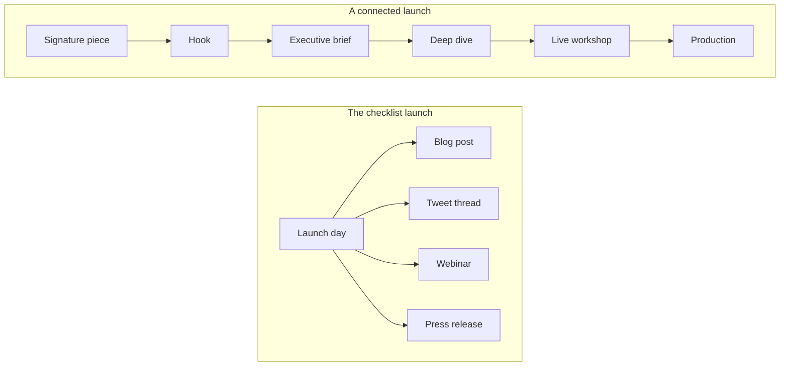
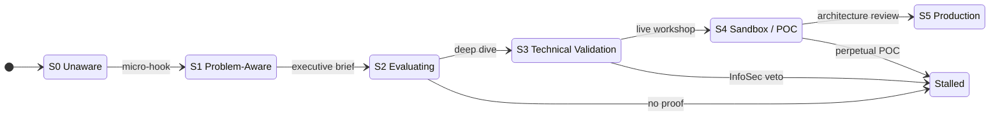

We've seen a lot of go-to-market launch packages: for new features, major versions, and whole new
product rollouts. Too many of them feel like a checklist. A blog post, a tweet thread, a webinar,
a press release, each one built in isolation and shotgunned out in the hope that something sticks.

We think about it differently. A launch should start from **one signature piece of content**
that's been thought through in depth, then be packaged into every form factor your buyers
consume. And every one of those assets should have a job: moving a prospect one step further
toward production.

To make that measurable, we model GTM as a **Markov chain**. Adoption isn't a passive, linear
funnel. It's a state machine, and every piece of content is a catalyst designed to raise the odds
that a prospect moves to the next state instead of stalling or churning.

## Why Listen to Us

- **Inside the platforms.** Our engineers have shipped production code and supported developer
  ecosystems at **ConsenSys (Infura)**, **Stellar Development Foundation**, and **Uphold**, so
  we've seen launches from the side that has to support them after the announcement.
- **On stage.** Talks at **ETH Denver 2023 & 2024**, **Devcon 2022 & 2024**, **ETH CC 2022**, and
  **ETH Seattle 2022** taught us which launches get builders to open a terminal.
- **In the classroom.** Courses for **LinkedIn Learning** and **Pluralsight** have reached
  thousands of developers. Turning one body of expertise into many formats is what curriculum
  design is.
- **In the funnel.** We apply the same state-machine thinking to
  [developer relations](/services/technical-articles/), so your launch and your long-term DevRel
  motion share one model and one set of metrics.

## Step 1: Architect the Signature Piece

In Web3 and fintech, institutional trust can't be manufactured with shallow ad copy. Before we
produce a single distribution asset, we build one high-density **signature piece**: an
architectural whitepaper, a benchmark report, or a production reference implementation.

Every downstream asset inherits its DNA from this source, so we calibrate six dimensions up front:

| Dimension           | What we calibrate                                                                                                                                      |
| ------------------- | ------------------------------------------------------------------------------------------------------------------------------------------------------ |
| **Scope**           | The exact system boundary (e.g. post-trade settlement finality or ERC-3643 on-chain compliance), not "the future of finance"                           |
| **Breadth**         | The full integration surface: business logic, cryptographic guarantees, legacy ERP and core-banking connectors, and regulatory controls                |
| **Depth**           | Down to the metal: p99 latency distributions, gas and throughput economics, failure modes, and deterministic state guarantees                          |
| **Tone**            | Authoritative, empirical, and pragmatic. No speculative hype; it reads like a principal architect briefing a risk committee                            |
| **Audience**        | Technical evaluators (staff engineers, security architects) who hold veto power, and economic buyers (VPs of product or treasury) who hold the budget  |
| **Technical level** | Uncompromisingly accurate at the core, with layered abstraction so executives grasp the commercial value while engineers can audit the exact mechanics |

## Step 2: Decompose It into Form Factors

Once the signature piece is done, we break it down into formats matched to the attention span and
context of each buyer state. Each one carries the rigor of the original, just at a different
length and depth.

<FeatureGrid>
  <FeatureCard icon="fa6-solid:lightbulb" title="Micro-Hooks" as="h3" bordered>
    X threads and single charts that isolate one counter-intuitive benchmark, state diagram, or
    economic invariant to stop the scroll.
  </FeatureCard>
  <FeatureCard icon="fa6-solid:briefcase" title="Executive Synthesis" as="h3" bordered>
    Long-form LinkedIn posts and punchy three-minute briefs that translate the breakthrough into
    capital efficiency, risk reduction, or compliance.
  </FeatureCard>
  <FeatureCard icon="fa6-solid:file-lines" title="Deep Technical Artifacts" as="h3" bordered>
    20+ minute engineering articles and GitHub repos that expose the full architecture, sequence
    diagrams, and trade-offs for technical due diligence.
  </FeatureCard>
  <FeatureCard icon="fa6-brands:youtube" title="Dynamic Visuals" as="h3" bordered>
    Short vertical clips that show one atomic workflow, and long-form walkthroughs of live
    telemetry, threat models, and code execution.
  </FeatureCard>
  <FeatureCard icon="fa6-solid:people-group" title="Kinetic Immersion" as="h3" bordered>
    Live workshops, architecture reviews, and sandbox hackathons where prospects run transactions
    against a testnet alongside your core engineers.
  </FeatureCard>
</FeatureGrid>

## Step 3: Map Every Asset to a State Transition

In a Markov chain, the chance of moving to the next state depends only on the current state, not
on the path that led there. Applied to GTM, that means you don't pitch production integration to
someone who's still unaware. Every asset is built to raise the odds of one specific transition,
and to keep prospects out of dead-end states like _ignored_, _stalled in InfoSec_, or _perpetual
POC_.

| Current state                | Prospect mindset                                                                       | Launch asset                                                    | Transition objective                                                          |
| ---------------------------- | -------------------------------------------------------------------------------------- | --------------------------------------------------------------- | ----------------------------------------------------------------------------- |
| **S0: Unaware / Skeptical**  | Filtering out crypto noise; assumes legacy rails are good enough                       | Tweet or short vertical video on a hard bottleneck or cost leak | Create cognitive dissonance and earn 30 seconds of attention                  |
| **S1: Problem-Aware**        | Sees the inefficiency (e.g. T+2 settlement drag) but doubts blockchain is viable       | LinkedIn post or punchy three-minute article                    | Establish credibility and category relevance; prompt internal sharing         |
| **S2: Solution-Evaluating**  | Comparing vendors; hunting for architectural flaws, latency issues, or compliance gaps | Deep-dive article, signature whitepaper, or long-form video     | Survive staff-engineer scrutiny and arm the internal champion                 |
| **S3: Technical Validation** | Convinced on paper, but wary of integration complexity and security risk               | Live workshop, self-serve sandbox, or audit matrix              | Get time-to-first-transaction under 30 minutes and neutralize InfoSec vetoes  |
| **S4: Sandbox / POC**        | Testing edge cases, throughput, and compliance reporting in staging                    | Custom architecture review, SLA, and governance package         | Move from experimental budget to core operational infrastructure              |
| **S5: Production**           | Running real volume                                                                    | Ongoing support and release content                             | Stay put: switching costs and embedded workflows make this an absorbing state |

## Step 4: Measure and Optimize the Chain

Treating GTM as a state model changes how you measure and tune a launch:

<CheckList>

- **Find the bottleneck state.** If prospects move quickly from problem-aware to evaluating (strong
  engagement on posts and articles) but almost never reach technical validation, your messaging
  works commercially. Your technical proof or compliance documentation is what's failing review.
- **Make every asset self-contained.** A Markov process is memoryless. A prospect who arrives via a
  peer-forwarded whitepaper never saw your launch tweets, so every asset carries enough context to
  stand on its own and points to the exact next step.
- **Engineer the absorbing state.** The goal is production integration, where high switching
  costs, embedded compliance workflows, and continuous transaction volume keep accounts from
  churning.

</CheckList>

## What We Offer

<FeatureGrid>
  <FeatureCard
    icon="fa6-solid:diagram-project"
    title="Launch Strategy & State Mapping"
    as="h3"
    bordered
  >
    We define your buyer states, identify the dead ends, and map which asset moves prospects through
    each transition.
  </FeatureCard>
  <FeatureCard icon="fa6-solid:pen-nib" title="Signature Piece" as="h3" bordered>
    A whitepaper, benchmark report, or reference implementation written by engineers, calibrated for
    both technical evaluators and economic buyers.
  </FeatureCard>
  <FeatureCard icon="fa6-solid:rss" title="Multi-Format Content Kit" as="h3" bordered>
    Threads, LinkedIn posts, short and long articles, vertical clips, and long-form videos, all
    derived from one source.
  </FeatureCard>
  <FeatureCard icon="fa6-solid:laptop-code" title="Workshops & Sandboxes" as="h3" bordered>
    Live workshops, architecture reviews, and sandbox environments that get prospects to their first
    transaction fast.
  </FeatureCard>
  <FeatureCard icon="fa6-solid:book-open" title="Technical Documentation" as="h3" bordered>
    Quickstarts and integration guides so new users can get started in minutes, not hours.
  </FeatureCard>
  <FeatureCard icon="fa6-solid:chart-line" title="Launch Analytics" as="h3" bordered>
    Instrumented transitions and a post-launch report showing where prospects advanced and where
    they stalled.
  </FeatureCard>
</FeatureGrid>
