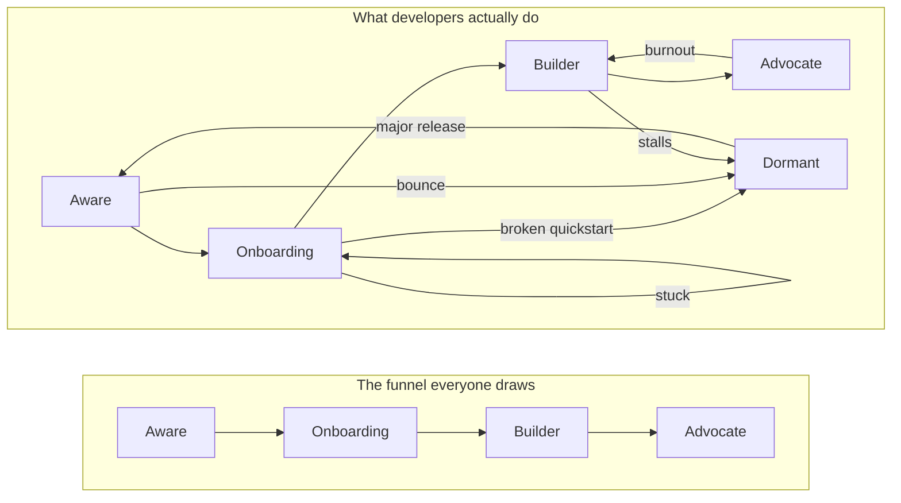
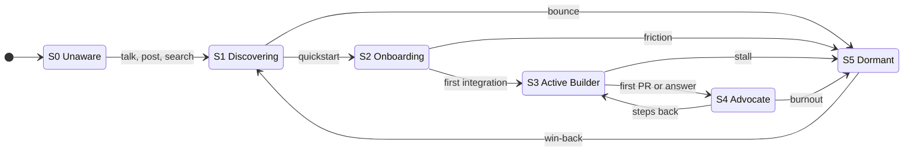
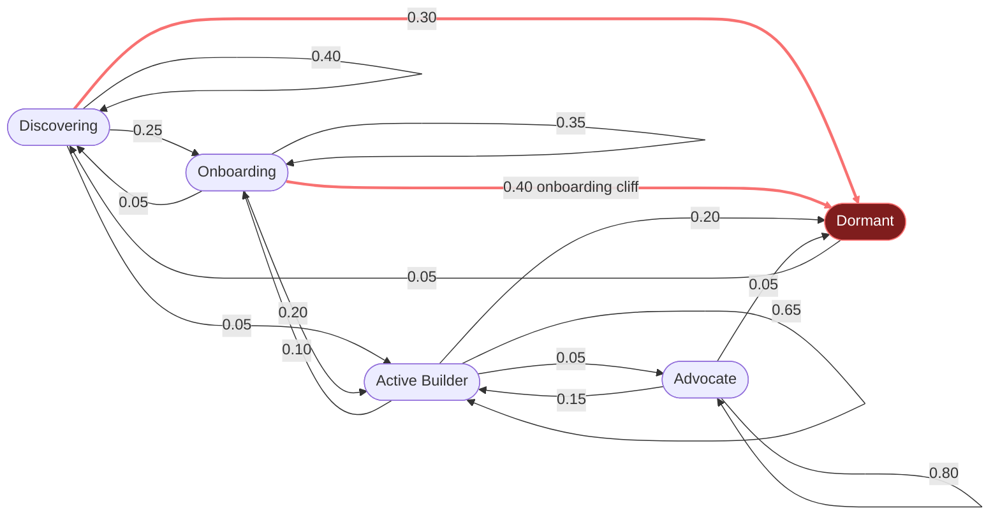
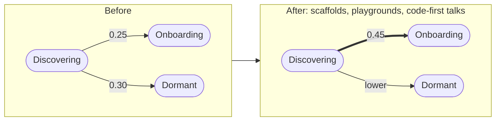
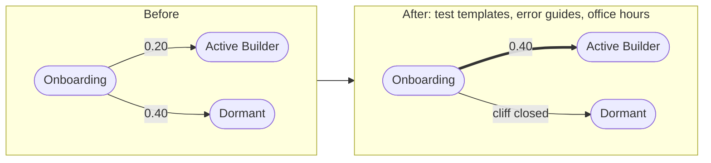
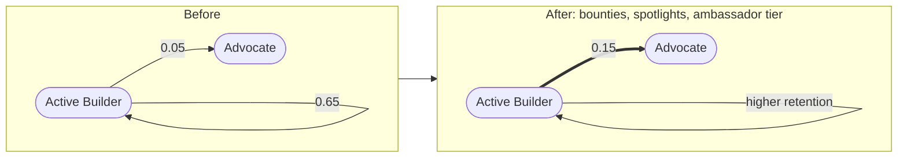
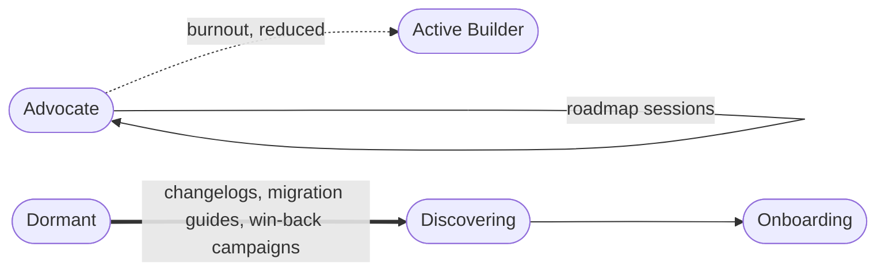
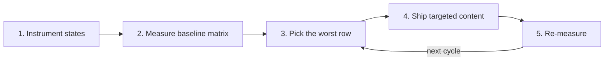
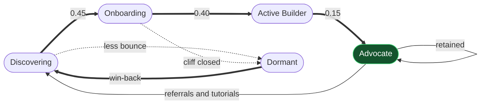

Most DevRel programs aren't short on effort. We've seen teams spend months on blog posts,
livestreams, swag, and hackathon booths and still struggle to answer the question leadership keeps
asking: **"What did all of that actually do?"**

The issue is the model they're working from. A typical funnel is drawn as a one-way slide from
"aware" to "customer." Developers don't behave like that. They bounce, stall in a sandbox for
weeks, churn after one broken quickstart, and come back six months later for a major release.

The simple answer is **Markov chains**. Nearly every quantitative, scientific, and engineering discipline uses them. But not DevRel.

A Markov chain is a mathematical model of states and transitions. In a DevRel context, the states are the stages of a developer's journey and the transitions are the probabilities of moving from one stage to the next. By measuring your actual churn data, you can see exactly where developers are dropping off to focus your efforts.

Each touchpoint is a lever that raises the odds of a developer moving forward.

The difference looks like this:

## Why Listen to Us

We've worked on every side of the developer funnel:

- **Inside the platforms.** Our engineers have shipped production code and supported developer
  ecosystems at **ConsenSys (Infura)**, **Stellar Development Foundation**, and **Uphold**, so we
  know what a developer hits between "sign up" and "first successful request."
- **On stage.** Talks at **ETH Denver 2023 & 2024**, **Devcon 2022 & 2024**, **ETH CC 2022**, and
  **ETH Seattle 2022** taught us what makes a room of builders go open a terminal and what makes
  them check their phones.
- **In the classroom.** Courses for **LinkedIn Learning** and **Pluralsight**, including _Web3
  Infrastructure Development Tools_ and smart contract development with Hardhat, Foundry, and
  ethers.js, have reached thousands of developers. Writing curriculum forces you to find every
  spot where a learner gets stuck.
- **In open source.** **945+ GitHub stars** across 200+ repositories, plus tools like
  [Foundry Anvil Testcontainers](/open-source/foundry-anvil-testcontainers/) and
  [WireMock Testcontainers](/open-source/wiremock-testcontainers/). We maintain the kind of
  projects we'll help you grow.
- **In the community.** Hands-on Discord and Telegram community management and viral campaigns
  that turn lurkers into contributors.

## The Developer Journey as a State Machine

At any point in time (say, a given week), every developer in your ecosystem is in exactly one
state:

| State                  | What it looks like                                             | Example signal                      |
| ---------------------- | -------------------------------------------------------------- | ----------------------------------- |
| **S0: Unaware**        | Outside your ecosystem                                         | None yet                            |
| **S1: Discovering**    | Reading docs, browsing repos, watching a talk                  | Docs visit, repo star               |
| **S2: Onboarding**     | Cloning starter kits, generating API keys, running local tests | API key created, template cloned    |
| **S3: Active Builder** | Integrating in staging or production, hitting usage milestones | 1,000+ weekly requests              |
| **S4: Advocate**       | Opening PRs, answering forum questions, writing tutorials      | 1+ merged PR or 5+ answered threads |
| **S5: Dormant**        | Gone quiet. Hard to recover, but not impossible                | No activity for 60+ days            |

This is a Markov chain: the chance of moving to the next state depends only on where a developer
is now. That simple assumption makes the whole funnel measurable.

## Find Your Bottleneck with a Transition Matrix

For each state, track where developers end up one period later. Here's a typical baseline for an
ecosystem that hasn't been tuned yet:

| From \ To          | Discovering | Onboarding | Active Builder | Advocate | Dormant  |
| ------------------ | ----------- | ---------- | -------------- | -------- | -------- |
| **Discovering**    | 0.40        | 0.25       | 0.05           | 0.00     | **0.30** |
| **Onboarding**     | 0.05        | 0.35       | 0.20           | 0.00     | **0.40** |
| **Active Builder** | 0.00        | 0.10       | 0.65           | 0.05     | 0.20     |
| **Advocate**       | 0.00        | 0.00       | 0.15           | 0.80     | 0.05     |
| **Dormant**        | 0.05        | 0.00       | 0.00           | 0.00     | 0.95     |

Read across a row and the problem jumps out. In this example, **40% of onboarding developers go
dormant every period**. That's the "onboarding cliff," and no amount of top-of-funnel awareness
content will fix it. More conference sponsorships just push more developers off the same cliff.

Drawn as a chain, with the thickest drop-offs in the baseline highlighted:

With absorbing-chain math (the fundamental matrix _N = (I − Q)⁻¹_), you can also work out how many
periods a developer typically takes to become an advocate or go dormant, and how much each
improvement shortens that time.

## How to Build a High-Impact Funnel

Every DevRel activity should be aimed at a specific transition. Here's the playbook we use, with
the kind of lift each stage is designed to produce.

### Stage 1: Discovering → Onboarding

**Goal:** Shorten time-to-first-hello-world (TTFHW) to minutes.

- Zero-config CLI scaffolds and starter templates
- Browser playgrounds so developers can try it before they install anything
- Short, code-first tutorials with opinionated architecture diagrams
- Conference talks that end with a repo link and a five-minute challenge, not a logo slide

**Target lift:** Discovering → Onboarding from **0.25 → 0.45**, with a lower bounce rate.

> **From our work:** Our ETH Denver and Devcon talks are built around runnable repos. The talk
> is the trailer and the repo is the product. Attendees leave with something cloned, not just a
> sticker.

### Stage 2: Onboarding → Active Builder

**Goal:** Get rid of integration friction and unblock early failures quickly.

- Error-message-driven troubleshooting guides ("If you see X, do Y")
- Integration testing templates such as local testnets and mock servers
- Live office hours and clear response-time SLAs on Discord and GitHub
- Migration and "production checklist" guides

**Target lift:** Onboarding → Active Builder from **0.20 → 0.40**, closing the onboarding cliff.

> **From our work:** We built [Foundry Anvil Testcontainers](/open-source/foundry-anvil-testcontainers/)
> and [WireMock Testcontainers](/open-source/wiremock-testcontainers/) because
> "how do I test this?" is where most Web3 integrations stall. Testing tooling is DevRel content.

### Stage 3: Active Builder → Advocate

**Goal:** Turn production competence into public social proof.

- "Good first issue" bounties and contributor guides
- Guest blog spotlights and case studies featuring community builders
- Co-speaking slots at meetups and conferences
- Early beta access and a champion or ambassador tier

**Target lift:** Active Builder → Advocate from **0.05 → 0.15**, plus better retention.

### Stage 4: Sustain Advocates and Win Back Dormant Developers

**Goal:** Prevent advocate burnout and bring dormant builders back.

- Direct roadmap input sessions with core engineers
- Release changelogs and migration guides aimed at developers who've gone dormant
- "What's changed since you left" email and content campaigns tied to major releases

## Putting It into Practice

1. **Instrument the states.** Map product and community signals to each state: API keys created,
   request volume, merged PRs, answered threads.
2. **Measure the baseline.** Track cohort movement month over month to fill in your real
   transition matrix.
3. **Pick one bottleneck.** Find the row with the highest dormancy probability. That's where your
   next quarter of effort goes.
4. **Ship targeted content.** Build the tutorials, tooling, and events aimed at that one
   transition.
5. **Re-measure.** Compare the matrix over the next two cycles. Keep what moved the numbers and
   cut what didn't.

When you're done, the report to leadership is a chart showing more developers reaching production,
faster.

The tuned chain after a few cycles:

## Sample Content

- [**Open-Source Web3 Ethereum Projects at Hella Labs**](/web3-ethereum-open-source/): an
  overview of our commitment to the ecosystem.
- [**High Performance dApps**](/websocket-sse-graphql-nestjs-thinclient/): a deep dive into
  reactive architecture for Web3.
- [**On-Chain Chaos Engineering**](/on-chain-chaos-engineering-ethereum-wiremock-anvil/):
  fault-injection testing for Ethereum apps with WireMock and Anvil.
- [**Solidity Lifecycle Testing**](/solidity-lifecycle-testing-foundry-anvil/): end-to-end
  contract testing with Foundry and Anvil.

## What We Offer

### DevRel Funnel Audit

We map your developer journey, instrument the states, and deliver your baseline transition matrix
along with a ranked list of your highest-leverage bottlenecks. You'll know exactly where developers
are dropping off and why.

### Technical Article Series

Multi-part series written by engineers who ship production code, matched to your audience's
experience level and backed by complete, runnable example repos. No fluff and no ghostwritten
filler, just content developers bookmark and share.

### Quickstarts, Starter Kits & Testing Templates

Zero-config scaffolds, sample apps, and integration testing templates that get a developer from
first visit to first successful call in minutes.

### Conference Talks & Workshops

Talks and hands-on workshops from speakers who've presented at ETH Denver, Devcon, and ETH CC,
built around a repo attendees will actually clone.

### Courses & Curriculum

Structured learning paths and workshop curriculum from instructors who've published with
LinkedIn Learning and Pluralsight.

### Community Programs

Discord and Telegram strategy, ambassador programs, bounty campaigns, and contributor onboarding
that turn your best builders into your loudest advocates.
